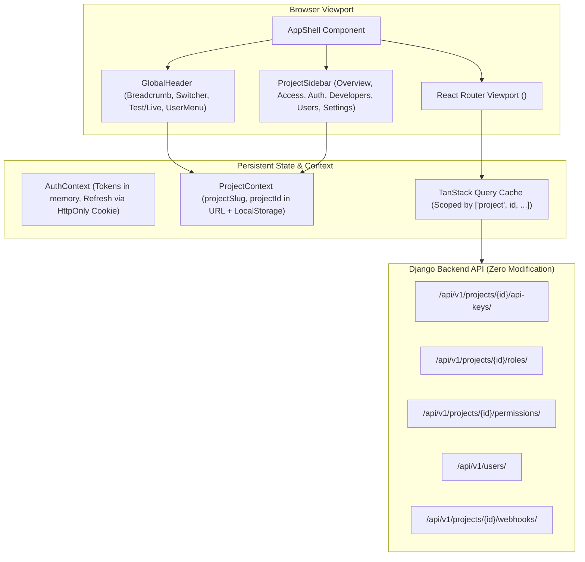

# HVT Dashboard Frontend Redesign & Design System Overhaul — Technical Design Document

* **Author:** Mark Odera
* **Date:** 2026-11-08
* **Status:** Approved Technical Specification
* **Predecessor Concept Brief:** [`concepts_brief.md`](file:///c:/Users/odera/Documents/GitHub/hvt/concepts_brief.md)

---

## 1. Overview, Problem Statement & Scope

### 1.1 Executive Summary
The HVT control-plane dashboard (`hvt-fr`) is undergoing a complete architectural, structural, and visual redesign. The initiative transforms the interface from a collection of monolithic, unvirtualized React components into a high-performance, developer-first platform. 

The target standard blends **Stripe's authoritative technical clarity** (keys, test/live states, webhooks, audit logs) with **Supabase's navigational ergonomics** (collapsible left sidebar plus spacious data tables), executed in HVT's original deep-space violet palette (`#000000`, `#0A0A0F`, `#12111A`, `#7C3AED`).

The delivery is structured into **5 independent vertical PR slices**, ensuring zero disruption to existing running workflows, complete WCAG 2.2 AA accessibility, zero backend modifications, and native compatibility with incoming roadmap milestones (Session Revocation, B2B Workspaces, Enterprise SAML/SCIM).

---

### 1.2 Problem Statement & Current Production Bottlenecks
A comprehensive code and live audit identified critical technical debt and UX friction in the current frontend:

1. **Monolithic "God Files":**
   * `SettingsPage.jsx` spans 858 lines handling profile, projects, roles, permissions, runtime auth, social providers, organization settings, and member invites in one unmaintainable tabbed component.
   * `ProjectUsersSection.jsx` (919 lines) and `ProjectAccessManager.jsx` (788 lines) suffer from similar architectural coupling.
2. **DOM Escalation & Silent Record Truncation at Scale:**
   * `ProjectAccessManager.jsx` queries permissions with `{ page_size: 100 }` and renders flat, unvirtualized lists. In a 200-permission test project, permissions 101–200 are completely invisible (silent truncation), while the desktop DOM height blows up to **15,545px** (3,399 DOM nodes) and mobile reaches **39,629px**.
   * `UsersPage.jsx` fetches 200 users and runs client-side slicing, dropping users 201–501.
3. **Pervasive "AI Slop" Design Hallmarks:**
   * Uppercase micro-tracking eyebrows (`text-xs uppercase tracking-[0.18em]`) plastered over inputs.
   * Pulsing dot indicators (`animate-ping`).
   * Sparkle icons (`Sparkles`) on technical onboarding and API key components.
   * Low-contrast body text (`#71717a` on `#111111` card surfaces yielding an inaccessible 3.2:1 contrast ratio, failing WCAG AA).
4. **Active Project State Volatility:**
   * Active project ID is stored in transient local component state (`useState`). Navigating across sidebar tabs resets the selected project, forcing repetitive re-selection.
5. **Dual-Plane API Key Blindspot:**
   * The API Key creation modal omits `key_type` and provisioning scopes, preventing developers from issuing Management Keys (`hvt_mgmt_...`) through the UI.

---

### 1.3 Developer Personas & Integration Triad
The HVT dashboard serves two primary developer personas:
1. **The Application Developer (Runtime Plane):**
   * Needs quick access to the **Integration Triad**: `HVT_BASE_URL`, `HVT_PROJECT_ID`, and Runtime Client Keys (`hvt_test_...` / `hvt_live_...`).
   * Tests authentication methods in the sandbox playground, manages social OAuth credentials, and inspects end-user signups.
2. **The Backend / Platform Engineer (Control Plane):**
   * Needs Management Keys (`hvt_mgmt_...`) for CI/CD declarative schema synchronization (`hvt sync`), role-to-permission mapping, webhook endpoint verification, and security audit log analysis.

---

### 1.4 In-Scope Goals vs. Out-of-Scope Non-Goals

#### In-Scope Goals
* **App Shell & Persistent Context:** Global header (org/project breadcrumbs, prominent copyable Project ID, accessible Test/Live toggle) + collapsible left sidebar driven by a URL-synchronized `ProjectContext`.
* **Dual-Plane API Key Management:** Segmented tabs for Runtime Client Keys vs. Management Keys, scope bundling, show-once secret display, and revoke workflows.
* **Onboarding & Setup Prompt:** 24-hour setup prompt key copy, CLI connection instructions pre-filled with the Integration Triad.
* **Scale-Proof Access Control:** Roles-by-permissions matrix grid with collapsible namespace accordions, paginated permissions table with debounced search, and side drawer editing.
* **Server-Paginated Tables:** Replacing flat lists with headless Radix + TanStack Table data grids supporting search, filtering, and column sorting.
* **Surface Invisible Features:** Decoupled UI for BYO Email Providers (`ProjectEmailConfig`), Schema Sync, and Passkey settings.
* **Accessibility & Theme Tokens:** Strict WCAG 2.2 AA compliance (minimum 4.5:1 text contrast using `#A1A1AA`), keyboard traversability, and purging arbitrary hex color drift.

#### Out-of-Scope Non-Goals
* **Zero Backend Code Changes:** No modifications to Django models, views, or endpoints. Backend gaps (such as `UserListView` lacking `project` filtering) are mitigated in frontend design and logged as separate upstream backend tasks (`TASK-BK-042`).
* **No Framework or Build Churn:** Maintain the existing React 18, Vite, React Query, and Tailwind CSS stack.
* **No Brand Identity Departure:** Preserve HVT's deep-space violet palette (`#000000`, `#0A0A0F`, `#12111A`, `#7C3AED`).

---

## 2. Architecture & System Design

### 2.1 Component & Routing Topology



---

### 2.2 Global Header Shell & Persistent Project Context

#### Header Specification
* **Breadcrumb Switcher:**
  * Displays: `[Organization Name] / [Project Select Dropdown]`.
  * Right beside the project selector, renders an explicit, copyable Project ID pill:
    `project_id: 8f4e2... [Copy]` with keyboard focus support (`Enter` / `Space` to copy, tooltip: "Copy Project ID").
* **Environment Switcher (Test vs. Live):**
  * Segmented pill switch (`role="switch"`, `aria-checked="true|false"`).
  * In `Test` mode: Renders an amber-toned top strip with high-contrast textual badge `"TEST MODE"`. Color alone is never used to convey mode.
* **Tenant & Environment Partitioning Rules:**
  1. `APIKey`: The only backend entity with an `environment` field (`test` vs `live`).
  2. `User (Runtime)`: Partitioned by `is_test` (`true` in Test mode, `false` in Live mode).
  3. All other entities (Roles, Permissions, Providers, Email, Webhooks, Platform Members) are project-wide and display an explicit `"Shared by Test and Live"` informational badge.

#### `ProjectContext` State Machine
```typescript
interface ProjectContextValue {
  activeProject: Project | null;
  activeProjectSlug: string;
  activeProjectId: string;
  environment: 'test' | 'live';
  setEnvironment: (env: 'test' | 'live') => void;
  selectProject: (projectSlug: string) => void;
  isLoading: boolean;
}
```
* **URL-First Synchronization:** The router recognizes `/dashboard/p/:projectSlug/...` (or query param `?project=:slug`). Changing the project updates the URL, invalidating relevant query cache keys (`['projects', projectId]`).
* **Fallback:** If no project is in the URL, `ProjectContext` reads the last active project from `localStorage.getItem('hvt_last_project')` or falls back to the organization's primary project.

---

### 2.3 Left Sidebar Navigation Hierarchy
The sidebar is permanently anchored to the left viewport on desktop (collapsible to icons) and slides over on mobile (`375px` viewport):

1. **Overview:** `/dashboard/overview` — System health, checklist, setup prompt modal.
2. **Access Control:**
   * **Roles & Permissions:** `/dashboard/access` — Roles-by-permissions matrix view, permission list table, role assignment drawer.
3. **Authentication:**
   * **Auth Methods:** `/dashboard/auth-methods` — Passkeys (WebAuthn), Passwords, TOTP 2FA, Magic Links.
   * **Social Providers:** `/dashboard/social-providers` — Google, GitHub, Apple, Discord, Microsoft, GitLab configurations.
   * **Email Delivery:** `/dashboard/email` — BYO SMTP, SES, Resend, Postmark configuration & test dispatcher.
4. **Developers:**
   * **API Keys:** `/dashboard/api-keys` — Dual-plane runtime client keys vs. management keys.
   * **Webhooks:** `/dashboard/webhooks` — Endpoints, event triggers, delivery logs.
   * **Audit Logs:** `/dashboard/audit-logs` — Security event stream, actor filters, inspector drawer.
5. **Runtime Users:** `/dashboard/runtime-users` — App runtime users, invitation dispatch, role assignments.
6. **Project Settings:** `/dashboard/settings` — Project name, slug, frontend URL, allowed origins, workspace slot.

---

### 2.4 Headless Component Strategy & Anti-AI Slop Design System

#### Headless UI Primitives
* Prerequisite command: `npm install @tanstack/react-table@^8.11.0`
* Primitive bindings via `@radix-ui/react-*` (Dialog, DropdownMenu, Select, Switch, Tabs, Checkbox, Separator, Slot).
* Tables utilize `@tanstack/react-table` headless controller wrapped in custom accessible semantic `<table>`, `<thead>`, `<tbody>`, `<tr>`, `<th>`, and `<td>` elements.

#### Strict Anti-AI Design Rules
1. **Purge Micro-Tracking Eyebrows:** Ban `text-xs uppercase tracking-[0.18em] text-[#71717a]`. Use clean sentence-case headings (`text-sm font-medium text-zinc-300`).
2. **Purge Pulsing Dots:** Ban `animate-ping` and oscillating borders. Use solid high-contrast status badges (`Badge variant="outline"`).
3. **Purge Sparkle Hype Icons:** Ban `Sparkles` and `Wand2`. Use technical icons (`Terminal`, `KeyRound`, `ShieldCheck`, `Layers`).
4. **Color Tokens & Contrast Ratio (WCAG 2.2 AA):**
   * Background Deep Canvas: `#000000`
   * Viewport Workspace Canvas: `#0A0A0F`
   * Card Surfaces / Drawers / Dialogs: `#12111A`
   * High-contrast borders: `#1E1535` / hover `#2D2248`
   * Primary Action Accent: `#7C3AED` / hover `#6D28D9`
   * Foreground text: Primary `#F0F0F3`, Secondary `#A1A1AA` (ensuring 4.6:1 contrast ratio against `#12111A`).

---

## 3. Vertical PR Slices & Execution Plan

### Slice 1: App Shell, Dual-Plane API Keys & Onboarding Quickstart

#### Deliverables & Scope
1. **Prerequisites:** Install `@tanstack/react-table@^8.11.0`.
2. **`ProjectContext`:** Implement `src/contexts/ProjectContext.jsx` and hook `useProject()`.
3. **`AppShell` Layout:** Implement `src/components/layout/AppShell.jsx`, `GlobalHeader.jsx`, and `ProjectSidebar.jsx`.
4. **Dual-Plane `ApiKeysPage.jsx` Redesign:**
   * Split into two distinct tabs:
     * `[ Runtime Client Keys ]` (`prefix: hvt_test_` / `hvt_live_`, scope: `auth:runtime`).
     * `[ Management Keys ]` (`prefix: hvt_mgmt_test_` / `hvt_mgmt_live_`, scopes: `schema:sync`, `roles:*`, `permissions:*`, `providers:*`).
   * Permanent Security Callout for Management Keys: *"Management keys bypass runtime boundaries and allow full schema provisioning. Never expose management keys in frontend or mobile apps."*
   * Create Key Modal: Prominent `key_type` segmented control, dynamic scope selection, show-once secret display with instant copy, and expiration date picker.
   * Integration Triad Bar: Top banner displaying `HVT_BASE_URL` and `HVT_PROJECT_ID` with one-click copy buttons.
5. **Onboarding Quickstart & Setup Prompt (`OnboardingQuickstart.jsx`):**
   * Update setup prompt modal copy to 24-hour key lifecycle.
   * Add CLI connection instructions pre-filled with the active Project ID and base URL.

#### Verification Gate for Slice 1
* Playwright test asserting:
  * Switching projects persists across navigation.
  * Creating a Runtime Key sends `key_type: "runtime"` with `auth:runtime`.
  * Creating a Management Key sends `key_type: "management"` with provisioning scopes.
  * Secret key is displayed only once and wiped on modal dismissal.
  * Zero `localStorage` secret leakage.

---

### Slice 2: Scale-Proof Roles & Permissions

#### Deliverables & Scope
1. **Roles-by-Permissions Matrix Grid (`ProjectRoleMatrix.jsx`):**
   * 2D interactive table mapping project roles against permissions.
   * Permissions grouped by namespace prefix (`users.*`, `auth.*`, `billing.*`).
   * Collapsible namespace accordions with count summary (e.g. `users (4 of 6 granted)`).
   * Sticky role column headers on vertical scroll; sticky permission row labels on horizontal scroll.
2. **Permissions Table (`ProjectPermissionsTable.jsx`):**
   * Server-paginated table utilizing `@tanstack/react-table` with debounced search (`filter_backends = [SearchFilter]`).
   * Eliminates the 15,545px DOM bloat; renders standard 20 records per page.
3. **Role Editor Side Drawer (`RoleDrawer.jsx`):**
   * Slide-over Radix Sheet replacing inline forms.
   * Synchronized with URL search params (`?drawer=role&id=<id>`).
   * Supports role creation, slug generation, description, and permission assignment.

#### Verification Gate for Slice 2
* Seed project with 200 permissions and 40 roles.
* Verify page height drops from 15,545px to under 900px with virtualized/paginated rendering.
* Verify debounced search returns matches within 100ms.

---

### Slice 3: Users Registry & Security Audit Logs

#### Deliverables & Scope
1. **Unified Platform & Runtime Users Table (`UsersTable.jsx`):**
   * Server-side pagination and search by email or name.
   * Environment filtering: When in `Test` mode, queries pass `?is_test=true`; in `Live` mode, pass `?is_test=false`.
   * Visible `Project` column badge identifying which project each runtime user belongs to.
   * Callout noting upstream backend task `TASK-BK-042` for server-side project filtering.
2. **User Detail Inspector (`UserDetailPage.jsx`):**
   * Assigned roles badge list and permission breakdown.
   * Direct user deletion action with confirmation dialog.
   * Reserved UI slot for **Step 7 (Active Session Revocation & Device Management)**.
3. **Audit Logs Table (`AuditLogsTable.jsx`):**
   * Event filtering, actor lookup, date range picker.
   * Expandable row inspector drawer displaying raw event payload JSON.

---

### Slice 4: Auth Methods, Providers, Email & Webhooks

#### Deliverables & Scope
1. **Decoupled Auth Methods (`AuthMethodsPage.jsx`):**
   * Passkeys / WebAuthn RP ID settings and registration testbed.
   * TOTP MFA toggle and enrollment preview.
   * Magic Links and Password policy configurations.
2. **Social Providers Manager (`SocialProvidersPage.jsx`):**
   * Card-based setup for Google, GitHub, Apple, Discord, Microsoft, GitLab.
   * Automated callback URL copy-paste generators.
3. **Bring-Your-Own Email Provider (`EmailConfigPage.jsx`):**
   * UI for `ProjectEmailConfig` (SMTP, AWS SES, Resend, Postmark, SendGrid).
   * Interactive "Send Test Email" drawer with status diagnostics.
4. **Webhooks & Deliveries (`WebhooksPage.jsx`):**
   * Endpoint creation drawer, event checklist, secret revelation.
   * Delivery logs table with status code badges and payload re-test action.

---

### Slice 5: Runtime "Try It" Console & Final Accessibility Polish

#### Deliverables & Scope
1. **Interactive Runtime Playground (`RuntimeConsolePage.jsx`):**
   * Interactive playground allowing developers to test login, passkey registration, token issuance, and claims inspection directly against their live project credentials.
2. **Final Accessibility & Contrast Audit:**
   * Automated `axe-core` run asserting zero WCAG 2.2 AA violations.
   * Keyboard focus and tab-order traversal across all drawers, dialogs, and tables.
   * Viewport validation across mobile (`375px`), tablet (`768px`), and desktop (`1440px`).

---

## 4. Forward Compatibility Slots (Steps 7–9)

The new sitemap and layout architecture explicitly provision non-intrusive slots for incoming roadmap backend capabilities:

1. **Step 7 (Session Revocation & Device Management):**
   * **Account Settings:** "Your Active Devices" card showing device icon, IP, browser, and "Revoke Other Sessions" button.
   * **User Detail View (`/dashboard/users/:id`):** "Active Sessions" sub-tab showing end-user JWT session IDs (`sid`) with admin remote kill switch.
2. **Step 8 (Workspaces / B2B Multi-Tenancy):**
   * **Global Header:** Breadcrumb switcher designed to expand from `[Org] / [Project]` into `[Org] / [Project] / [Workspace]` once tenant claims land in the backend.
3. **Step 9 (Enterprise SAML/SCIM & Delegated Agent Tokens):**
   * **Authentication Sidebar:** Sub-section for "Enterprise SSO" (SAML IdP metadata upload, ACS URLs) and "Directory Sync" (SCIM token generation and sync logs).
   * **API Keys Page:** Secondary tab for "Delegated Agent Tokens" with restricted execution boundaries.

---

## 5. Testing, Security & Quality Validation

### 5.1 Security Invariants
* **Show-Once Key Display:** Raw API keys (`hvt_...` or `hvt_mgmt_...`) are held strictly in React component state (`useState`) during generation and discarded permanently upon modal close.
* **Zero Browser Secret Storage:** `localStorage` and `sessionStorage` are audited to ensure zero tokens, secrets, or PII are stored. Authentication uses in-memory tokens refreshed via `HttpOnly` cookies.
* **Sanitized Rendering:** Zero use of `dangerouslySetInnerHTML`. All JSON payloads and webhook bodies are rendered through structured code viewers.

### 5.2 Verification Deliverables per Slice
Every PR slice must include:
1. Automated unit & component tests using Vitest/React Testing Library.
2. Automated Playwright test verifying the primary user flows.
3. Desktop and mobile screenshots saved to `docs/audit/screens/` demonstrating visual compliance.
4. An isolated Goldfish review asserting code quality and invariant compliance before merge.
