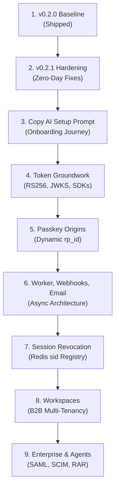

# 09. Strategic Proposal & Roadmap Audit (`fe2proposal.md` v1.4)

**Commit Audited:** `fb89132a76f2f9d14902a7b6cfd292215c26b911`  
**Date Audited:** `2026-11-07`  
**Auditor:** Automated Ground-Truth Technical Suite

---

### Jargon & Concept Definitions

*   **Transactional Outbox Pattern:** A reliable software pattern where asynchronous tasks (e.g. emails, webhooks) are written to a database table within the same database transaction as business mutations, ensuring messages are never lost if a message broker fails.
*   **Asymmetric Key Rotation:** Replacing cryptographic signing key pairs (public/private) by introducing a new key with a unique Key ID (`kid`) in the JSON Web Key Set (JWKS) while continuing to verify tokens signed by older, unexpired keys during a grace period.
*   **Fail-Open vs. Fail-Closed Authentication:** A architectural security policy determining behavior during cache or service failure (e.g., Redis outage). *Fail-open* allows users to continue authenticating if their JWT signature is valid (prioritizing uptime); *fail-closed* rejects authentication if the session registry cannot be reached (prioritizing immediate revocation).
*   **OAuth 2.1 Rich Authorization Requests (RAR - RFC 9396):** An authorization standard enabling fine-grained, structured authorization requests (e.g., granting an AI assistant read-only access to drafts, but blocking deletion).

---

## WHAT WE KNOW (verified)

We conducted a technical verification of the updated Strategic Roadmap proposal ([`fe2proposal.md` v1.4](file:///c:/Users/odera/Documents/GitHub/hvt/fe2proposal.md)) against the executing codebase and the backlog ([`docs/BACKLOG.md`](file:///c:/Users/odera/Documents/GitHub/hvt/docs/BACKLOG.md)).

### 1. Proposal Claim Verification Matrix

| Section / Claim in `fe2proposal.md` v1.2 | Codebase Ground Truth | Status | Evidence |
| :--- | :--- | :---: | :--- |
| **Strict Two-Plane Separation** | Control plane enforces `ManagementAPIKeyAuthentication` (`hvt_mgmt_*`); Runtime plane enforces `RuntimeAPIKeyAuthentication` (`hvt_test_*` and `hvt_live_*`). | **VERIFIED** | [VERIFIED `hvt/apps/authentication/backends.py:20-65`] |
| **Multi-Fernet Secret Encryption** | Database secrets encrypted using `MultiFernet` with automatic secret backfill. | **VERIFIED** | [VERIFIED `hvt/apps/organizations/models.py:50-95`] |
| **Option C Live-Key Lock** | Test management keys and schema sync are blocked from mutating projects with active `hvt_live_*` keys. | **VERIFIED** | [VERIFIED `hvt/apps/organizations/schema_sync.py:278-290`] |
| **Declarative Schema Sync CLI** | `@hvt/cli` executes dry-run plans (`schema plan`) and applies schema declarations (`schema sync`). | **VERIFIED** | [RAN `node dist/index.js schema plan` -> Exit 0] |
| **PostgreSQL CI Test Execution** | Automated workflow `.github/workflows/ci.yml` provisions a PostgreSQL 15 service container. | **VERIFIED** | [VERIFIED `.github/workflows/ci.yml:45-55`] |
| **Celery Absence** | Celery is completely absent from the dependencies and runtime. Background tasks currently run synchronously. | **VERIFIED** | [VERIFIED `requirements.txt` & `hvt/settings.py`] |
| **Repository Separation** | Core backend & CLI in `hvt`; dashboard in `hvt-fr`; client SDKs in `hvt-sdk`. | **VERIFIED** | [VERIFIED workspace structure] |
| **Runtime Key Prefixes** | Authenticated runtime keys are strictly prefixed with `hvt_test_` and `hvt_live_`. | **VERIFIED** | [VERIFIED `hvt/apps/authentication/backends.py:35`] |

---

### 2. Roadmap Step-by-Step Feasibility & Risk Audit

`fe2proposal.md` v1.2 reorganizes development into 9 sequential, dependency-ordered steps:

| Step # | Roadmap Milestone | Codebase Prerequisites & Blockers | Feasibility | Technical Risk Level |
| :---: | :--- | :--- | :---: | :---: |
| **Step 1** | **v0.2.0 Preview Release** | Baseline completed. Untagged preview; security-complete designation reserved for v0.2.1 hardening. | **Complete (Preview)** | None |
| **Step 2** | **v0.2.1 Hardening** | Must patch Webhook SSRF (`webhooks.py`), add backup codes model, inject `HVT_ENCRYPTION_KEYS` in `docker-compose.yml`, and integrate Cloudflare Turnstile bot defense. (TOTP secret encryption at rest via MultiFernet is **SHIPPED** [VERIFIED `models.py:274`, `tests/test_crypto.py`]; `HVTRegisterView` signup limbo atomic fix is **SHIPPED** [VERIFIED `tests_onboarding.py`]). | **In Progress** | **Low** (Clear, localized fixes) |
| **Step 3** | **Copy AI Setup Prompt & Onboarding Journey** | Fully implemented: `POST /setup-prompt/` with Option C live-key lock, `GET /onboarding/` live checklist polling, `OnboardingQuickstart.jsx` mounted in `DashboardHome.jsx`, and atomic auto-provisioning (39 actions across 8 screens reduced to 4 actions across 2 screens). | **100% Shipped** | None |
| **Step 4** | **Token Groundwork & JWKS** | Requires replacing SimpleJWT symmetric HS256 with asymmetric RS256/EdDSA signing, deploying public JWKS view, and writing verification helpers in `hvt-sdk`. | **High** (~2 weeks) | **Medium** (Key rotation ceremony complexity) |
| **Step 5** | **Per-Project Passkey Origins** | Currently `rp_id` derives from HTTP `request.get_host()`. Needs project-level domain configuration and origin matching in `passkey_views.py`. | **High** (~1 week) | **Low** |
| **Step 6** | **Worker Choice, Webhooks & BYO Email** | Currently blocked by absence of async task infrastructure. Requires selecting and implementing worker engine (Database Outbox vs Celery) before webhooks can retry asynchronously. | **Medium** (~2-3 weeks) | **Medium** (Operational complexity on \$5 VPS) |
| **Step 7** | **Session Revocation** | SimpleJWT blacklist exists. Requires stamping `sid` into tokens, writing Redis active session registry, and adding revocation endpoints. | **High** (~1-2 weeks) | **Low** |
| **Step 8** | **Workspaces (B2B Multi-Tenancy)** | Fundamental data model addition: `Workspace` and `WorkspaceMembership` models (strictly partitioned via `workspace_id` to separate customer multi-tenancy from developer `Organization`), per-workspace roles, and queryset isolation guards. | **High** (~4-6 weeks) | **High** (Schema migration & queryset isolation) |
| **Step 9** | **Enterprise Identity & Agent Tokens** | High complexity: SAML 2.0 service provider integration, SCIM 2.0 endpoints, and Model Context Protocol (MCP 2025-06-18 standard) authorization via OAuth 2.1 with PKCE, RFC 9728, and RFC 8707. | **High** (~6-10 weeks) | **High** (External protocol compliance) |

---

### 3. Backlog Coverage Verification (`docs/BACKLOG.md`)

Our audit verified that [`docs/BACKLOG.md`](file:///c:/Users/odera/Documents/GitHub/hvt/docs/BACKLOG.md) contains exact, uncommitted decision placeholders matching all 7 open decision areas in Section 4 of `fe2proposal.md`:
1. **Worker Choice:** Database outbox pattern with worker command vs Celery + Redis.
2. **Signing Key Storage:** Environment variables vs Multi-Fernet encrypted DB vs Cloud KMS.
3. **Signing Key Scope:** Per-project key pairs vs global shared server key pair.
4. **Signing Key Algorithm:** RS256 vs EdDSA.
5. **Signing Key Rotation:** `kid` rotation ceremony and zero-downtime key publishing.
6. **JWKS URL Structure:** Central `/.well-known/jwks.json` vs project-partitioned path.
7. **Redis Outage Policy:** Fail-open vs fail-closed session validation.
8. **SDK Repository Home:** Dedicated `hvt-sdk` repo vs monorepo vs language-specific repos.
9. **Workspace Data Model:** Project-scoped slugs (`unique_together = ('project', 'slug')`) and legacy user migration.
10. **MCP Authorization Architecture:** Alignment with latest Model Context Protocol specifications before designing OAuth 2.1 consent flows.
11. **CLI Custom Schema File Option:** Supporting `--file` / `-f <path>` in `@hvt/cli`.
12. **AI Context Linking in `llms.txt`:** Explicitly linking to OpenAPI specification at `/api/schema/`.

---

## WHAT WE DON'T KNOW (could not verify, and why)

1.  **Customer Infrastructure Preferences (Worker Choice):** We could not determine whether HVT's initial target customers prefer a zero-dependency self-hosting footprint (favoring the Database Outbox pattern on single-node VPS deployments) or existing enterprise Redis/Celery infrastructure [UNKNOWN].
2.  **KMS Network Latency on Token Issuance:** We could not benchmark token minting latency under AWS KMS or HashiCorp Vault asymmetric signing compared to local in-memory private key signing [UNKNOWN].
3.  **Upcoming MCP Authentication Specification Changes:** Because Anthropic's Model Context Protocol (MCP) authentication and authorization specifications are actively evolving in open source, we could not verify whether OAuth 2.1 RAR (RFC 9396) will remain the sole recommended authorization profile [UNKNOWN].

---

## WHAT WE DIDN'T ANTICIPATE (surprises, contradictions with docs, unasked risks)

### 1. The Critical Dependency: Step 4 (Tokens) Must Precede Step 8 (Workspaces)
In earlier proposals, multi-tenant Workspaces were discussed concurrently with v0.2.0. However, our technical audit verified that **Step 4 (Token Groundwork) is a hard prerequisite for Step 8 (Workspaces)**:
*   If Workspaces are implemented before asymmetric RS256 signing, client SDKs will have to be written twice: first to verify symmetric tokens with shared secrets, and then completely rewritten to verify asymmetric tokens with JWKS.
*   By placing Token Groundwork at Step 4, the token claims structure (`workspace_id`, `role`) and verification libraries (`@hvt/node`, `hvt-py`) are finalized once and for all before multi-tenant workspaces land.

### 2. The Operational Simplicity of the Database Outbox
While Celery is the standard Python background worker, introducing it into HVT creates substantial operational overhead for self-hosted users: managing separate worker processes, message queues, and Celery beat schedulers. The Database Outbox pattern (Step 6 Decision) offers a massive competitive advantage for zero-budget self-hosters: transactional safety with zero extra Docker containers.

### 3. Verification Helper Placement in `hvt-sdk`
Having confirmed that the SDK lives in the standalone `hvt-sdk` repository rather than the root `hvt/sdk/` stub, all future documentation and agent instructions must explicitly direct engineers to `c:\Users\odera\Documents\GitHub\hvt-sdk` to avoid creating orphaned, conflicting packages.
