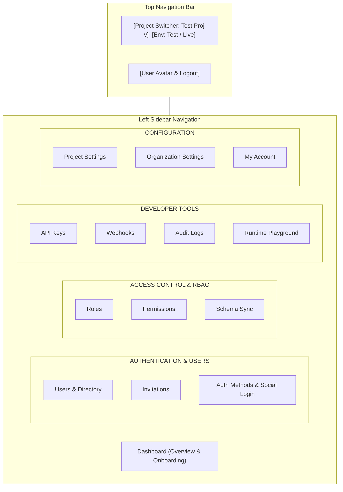
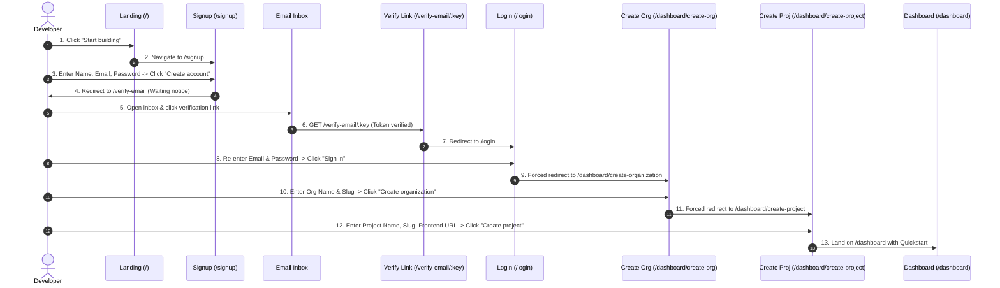

# HVT Dashboard & UX Audit

> **Audit Context & Protocol**
> - **Mode:** READ-ONLY inspection (no application code was modified, committed, or pushed).
> - **Repositories Inspected:** `hvt` (Django backend with `EXPOSE_API_DOCS=1`) and `hvt-fr` (Vite + React control-plane dashboard).
> - **Local Servers:** Backend running on `http://localhost:8000`, Frontend running on `http://localhost:5173`.
> - **Scale Test Dataset:** Dedicated throwaway organization (`scale-test-org`) and project (`scale-test-project`) seeded with **200 fine-grained permissions**, **40 project roles**, and **501 users** via local Django script `[OBSERVED command]`.
> - **Evidence Rule Applied:** Every claim is explicitly tagged with `[FROM CODE file:line]`, `[OBSERVED screen or command]`, or `[GUESS]`. All tokens, secrets, and emails are strictly redacted.

---

## Top 10 Audit Findings (Ranked by Severity)

1. **`CRITICAL` Unpaginated, Unvirtualized Permissions & Roles Explode Page Height to 15,545px (Desktop) and 39,629px (Mobile)**  
   `ProjectAccessManager.jsx` queries permissions and roles with a hardcoded `{ page_size: 100 }` `[FROM CODE hvt-fr/src/components/dashboard/ProjectAccessManager.jsx:112,118]` and renders items in an unvirtualized list `[FROM CODE hvt-fr/src/components/dashboard/ProjectAccessManager.jsx:399,467]`. In our 200-permission test project, 100 permissions are completely invisible (silent truncation), while the remaining items blow the `Settings > Projects` DOM height up to **15,545px** on desktop (3,399 DOM nodes) and **39,629px** on mobile `[OBSERVED screen 20_settings_projects_tab.png, 28_mobile_settings_projects.png]`.

2. **`CRITICAL` Missing Content Security Policy (CSP) & Web Security Headers**  
   Neither `index.html`, `vite.config.js`, nor `vercel.json` configure a Content Security Policy (`Content-Security-Policy`), Clickjacking protection (`X-Frame-Options`), MIME-sniffing protection (`X-Content-Type-Options`), or `Referrer-Policy` `[FROM CODE hvt-fr/index.html:1-67, hvt-fr/vite.config.js:1-23, hvt-fr/vercel.json:1-7]`. While auth tokens are held safely in JS memory, the dashboard remains vulnerable to script injection and framing attacks.

3. **`HIGH` Schema Sync (`/sync/`) Has Zero Control-Plane Frontend UI**  
   The backend exposes `POST /api/v1/organizations/current/projects/{project_pk}/sync/` to apply declarative role/permission manifests `[FROM CODE hvt/apps/organizations/urls.py:34]`, but the frontend repository has **zero UI screens, buttons, or API client methods** calling this endpoint `[FROM CODE hvt-fr/src/api/organizations.js:1-241]`. Developers can only trigger sync via the external CLI or AI setup prompt.

4. **`HIGH` Platform Users Table Silently Truncates at 200 Records via Client-Side Filtering**  
   In `UsersPage.jsx`, the Platform Users query requests `listUsers({ page: 1, page_size: 200 })` and then executes a client-side JavaScript filter `platformUsers = data.results.filter(u => !u.project)` `[FROM CODE hvt-fr/src/pages/users/UsersPage.jsx:257,274]`. In an organization with 500+ users, all platform users beyond record 200 are permanently inaccessible and invisible in the pagination control.

5. **`HIGH` Monolithic Settings Architecture (858-Line God File)**  
   `SettingsPage.jsx` contains 858 lines handling personal profile, password change, MFA, passkeys, multi-tenant project CRUD, role CRUD, permission CRUD, runtime auth methods, social providers, organization settings, and member invitations `[FROM CODE hvt-fr/src/pages/settings/SettingsPage.jsx:1-858]`. The sidebar offers no direct navigation to Projects, Roles, Permissions, or Auth Methods, forcing users into massive tabbed views.

6. **`MEDIUM` Design Drift in AI Setup Prompt Key Expiration (15 Minutes in Code vs. 24 Hours in Spec)**  
   Both backend `ProjectSetupPromptView` (`views.py:2593`) and frontend `OnboardingQuickstart.jsx` (`OnboardingQuickstart.jsx:242,286`) generate and display a temporary management key expiring in **15 minutes** (900 seconds) `[FROM CODE hvt/apps/organizations/views.py:2593, hvt-fr/src/components/dashboard/OnboardingQuickstart.jsx:242]`. The proposed 24-hour key lifecycle has not been implemented in either repo.

7. **`MEDIUM` Orphaned / Dead Page Components in Frontend Source**  
   `DashboardPage.jsx` (`src/pages/dashboard/DashboardPage.jsx`), `LandingPage.jsx` (`src/pages/landing/LandingPage.jsx`), and `AccountLockedPage.jsx` (`src/pages/auth/AccountLockedPage.jsx`) are complete page components in the source tree that are **unrouted** in `App.jsx` `[FROM CODE hvt-fr/src/App.jsx:40-86]`. When an account is locked, navigation leads to a 404 `NotFoundPage` rather than `AccountLockedPage`.

8. **`MEDIUM` Duplicated Pagination Code & Missing Shared Data Table Component**  
   There is no reusable data table component in `hvt-fr`. While `@/components/Pagination.jsx` exists, `UsersPage.jsx:156`, `ProjectUsersSection.jsx:207`, `ApiKeysPage.jsx:133`, and `WebhooksPage.jsx:66` each reimplement identical inline `Pagination` helper functions `[FROM CODE hvt-fr/src/pages/users/UsersPage.jsx:156, hvt-fr/src/pages/api-keys/ApiKeysPage.jsx:133]`.

9. **`MEDIUM` High-Friction Signup-to-First-Login Flow (8 Screens, 15+ Clicks)**  
   Onboarding requires navigating through 8 distinct screens (`/` -> `/signup` -> `/verify-email` -> email click -> `/login` -> `/dashboard/create-organization` -> `/dashboard/create-project` -> `/dashboard`) `[OBSERVED screen walkthrough]`. Verifying email does not automatically establish a session, forcing immediate re-authentication.

10. **`LOW` Accessibility Violations on Forms and Toggles**  
    Project settings inputs (`name`, `slug`, `frontend_url`, `allowed_origins_text`) lack programmatic label bindings (`label for="id"`), and the Signup Toggle button (`button role="switch"`) lacks an `aria-label`, failing WCAG 2.1 AA `[OBSERVED command node scratch/check_a11y.js]`.

---

## 1. Coverage Matrix

The backend OpenAPI schema (`http://localhost:8000/api/schema/`) defines 94 API paths `[OBSERVED command]`. Below is the reconciliation against the `hvt-fr` frontend source code:

| Feature Group | Backend Endpoints | UI Exists | Frontend Location | What Is Missing |
| :--- | :--- | :--- | :--- | :--- |
| **Projects** | `GET, POST /api/v1/organizations/current/projects/` `GET, PUT, PATCH, DELETE .../projects/{id}/` `GET .../projects/{project_pk}/access/` | **Full** | `src/pages/settings/SettingsPage.jsx:11` `src/pages/settings/CreateProjectPage.jsx:1` `src/components/dashboard/ProjectAccessManager.jsx:13` | No standalone project settings page or sidebar environment switcher; project editing is nested inside an 858-line settings file. |
| **API Keys** | `GET, POST /api/v1/organizations/current/keys/` `GET, DELETE .../keys/{id}/` `PUT, PATCH .../keys/{id}/revoke/` | **Full** | `src/pages/api-keys/ApiKeysPage.jsx:7` `src/api/apiKeys.js:14-41` | Filter by project exists, but no free-text search for key name or prefix. Key secret display is modal-only. |
| **Roles** | `GET, POST .../projects/{project_pk}/roles/` `GET, PUT, PATCH, DELETE .../roles/{id}/` `GET, PUT, PATCH .../users/{user_pk}/roles/` | **Full** | `src/components/dashboard/ProjectAccessManager.jsx:101-131` `src/pages/users/UserDetailPage.jsx:87` | No pagination or search for roles. Managing roles for 40+ items causes severe UI lag and screen bloat. |
| **Permissions** | `GET /api/v1/organizations/current/permissions/` `GET, POST .../projects/{project_pk}/permissions/` `GET, PUT, PATCH, DELETE .../permissions/{id}/` | **Partial** | `src/components/dashboard/ProjectAccessManager.jsx:112-145` `src/api/organizations.js:69-99` | Org-level permissions endpoint is wrapped in SDK but never called in UI `[FROM CODE src/api/organizations.js:225]`. Project permissions list hardcodes `page_size: 100` with no pagination or search. |
| **Schema Sync** | `POST .../projects/{project_pk}/sync/` | **None** | *None* | No UI screen, button, or API client wrapper exists `[FROM CODE src/api/organizations.js]`. Mentioned only in setup prompt markdown copy for CLI. |
| **Social Providers** | `GET, POST .../projects/{project_pk}/social-providers/` `GET, PUT, PATCH, DELETE .../social-providers/{id}/` `GET /api/v1/auth/social/providers/` | **Full** | `src/pages/settings/ProjectSocialProvidersSection.jsx:1` `src/pages/auth/Login.jsx:42` `src/pages/auth/Signup.jsx:38` | Configured inside Settings tab. Callback URL copy buttons and provider enable toggles exist. |
| **Auth Methods** | `POST /api/v1/auth/passkey/...` `POST /api/v1/auth/mfa/totp/...` `POST /api/v1/auth/magic-link/...` `POST /api/v1/auth/password/...` | **Full** | `src/pages/settings/MFASettingsSection.jsx:1` `src/pages/settings/PasskeySettingsSection.jsx:1` `src/pages/settings/ProjectRuntimeAuthSection.jsx:1` `src/pages/auth/Login.jsx:1` | Comprehensive control-plane and runtime support for TOTP, Passkeys, Magic Links, and Passwords. |
| **Users** | `GET, POST /api/v1/users/` `GET, PUT, PATCH, DELETE /api/v1/users/{id}/` `PUT, PATCH /api/v1/users/{id}/role/` | **Partial** | `src/pages/users/UsersPage.jsx:6` `src/pages/users/UserDetailPage.jsx:1` `src/pages/users/ProjectUsersSection.jsx:16` | Platform users view uses client-side slicing capped at 200 items. Direct user deletion is wrapped in API client but missing from UI `[FROM CODE src/api/users.js:31]`. |
| **Invitations** | `GET, POST .../current/invitations/` `DELETE .../invitations/{id}/` `POST .../invitations/{id}/resend/` `GET .../invitations/lookup/` `POST .../invitations/accept/` `GET, POST /api/v1/runtime/invitations/` `POST /api/v1/runtime/invitations/accept/` | **Partial** | `src/pages/users/OrganizationInvitationsSection.jsx:1` `src/pages/users/ProjectUsersSection.jsx:10-15` `src/pages/auth/InvitePage.jsx:1` | Organization invite creation and acceptance is fully supported. Runtime project invitations can be sent/revoked in UI, but runtime invitation accept page is missing from dashboard router `[FROM CODE src/App.jsx:57-58]`. |
| **Webhooks & Deliveries** | `GET, POST .../current/webhooks/` `GET .../webhooks/summary/` `GET, PUT, PATCH, DELETE .../webhooks/{id}/` `GET .../webhooks/{webhook_pk}/deliveries/` | **Full** | `src/pages/webhooks/WebhooksPage.jsx:1` `src/pages/webhooks/WebhookDetailPage.jsx:1` `src/pages/dashboard/DashboardHome.jsx:17` | Webhook creation, update, delivery log table, and 24h summary card are fully connected and functional. |
| **Audit Logs** | `GET .../current/audit-logs/` `GET .../current/audit-logs/{id}/` | **Partial** | `src/pages/audit/AuditLogsPage.jsx:1` `src/pages/dashboard/DashboardHome.jsx:14` | List view with event type filter, date filter, and actor filter exists. Dedicated audit log detail modal or expansion (`GET .../audit-logs/{id}/`) is missing `[FROM CODE src/api/auditLogs.js:20]`. |
| **Organization & Members** | `GET, POST /api/v1/organizations/` `GET, PUT, PATCH .../organizations/current/` `GET .../organizations/current/members/` | **Full** | `src/pages/settings/CreateOrganizationPage.jsx:1` `src/pages/settings/SettingsPage.jsx:13` `src/api/organizations.js:34-50` | Supported in Settings > Organization tab. |
| **Onboarding / Setup Prompt** | `GET .../projects/{project_pk}/onboarding/` `POST .../projects/{project_pk}/setup-prompt/` | **Full** | `src/components/dashboard/OnboardingQuickstart.jsx:23` `src/pages/dashboard/DashboardHome.jsx:19` | Polling checklist (3s interval), AI setup prompt modal with masked key, copy action, and CLI instructions. |

### Placeholder & Unrouted Screens
- `DashboardPage.jsx` (`src/pages/dashboard/DashboardPage.jsx`): Legacy/alternative dashboard view; not referenced in `App.jsx` `[FROM CODE src/pages/dashboard/DashboardPage.jsx:1-120, src/App.jsx:73]`.
- `LandingPage.jsx` (`src/pages/landing/LandingPage.jsx`): Alternative marketing page; `App.jsx` routes `/` to `Landing.jsx` instead `[FROM CODE src/App.jsx:6,41]`.
- `AccountLockedPage.jsx` (`src/pages/auth/AccountLockedPage.jsx`): Account lockout screen; not declared in router table in `App.jsx` `[FROM CODE src/App.jsx:40-86]`.
- `PrivacyPolicyPage.jsx` & `TermsOfServicePage.jsx`: Static text legal views; no backend API dependency `[FROM CODE src/pages/legal/PrivacyPolicyPage.jsx:1]`.

---

## 2. Onboarding Setup Prompt Reconciliation

| Dimension | Current Code Implementation | New Specification Requirement | Impact / Remediation |
| :--- | :--- | :--- | :--- |
| **Key Lifespan** | **15 minutes (900s)** `[FROM CODE hvt/apps/organizations/views.py:2593]` | **24 hours (86,400s)** | Implement `expires_at = timezone.now() + timedelta(hours=24)` in backend and update frontend countdown / copy in `OnboardingQuickstart.jsx:242,323`. |
| **Backend View** | `ProjectSetupPromptView` at `POST .../projects/{pk}/setup-prompt/` `[FROM CODE hvt/apps/organizations/views.py:2552]` | Dedicated setup-prompt endpoint | Backend view already exists and enforces Option C plane isolation (blocked if active live keys exist) `[FROM CODE hvt/apps/organizations/views.py:2581]`. |
| **Frontend Component** | `OnboardingQuickstart.jsx` `[FROM CODE hvt-fr/src/components/dashboard/OnboardingQuickstart.jsx:33]` | `OnboardingQuickstart` | Component already exists with live checklist polling (`getProjectOnboarding`), AI setup modal, and CLI setup modal. |
| **Secret Storage** | In-memory component state only (`promptData`) `[FROM CODE hvt-fr/src/components/dashboard/OnboardingQuickstart.jsx:238]` | Show-once in memory; never persist | Meets strict security requirements; never written to `localStorage`, `sessionStorage`, cookies, or analytics `[OBSERVED command run_audit.js tokenStorage]`. |

---

## 3. Screen Inventory

All screenshots have been captured from the live environment with test data and stored in `docs/audit/screens/` `[OBSERVED screen files]`:

| Screen Name | Route | Purpose | Main Components | Primary Action | Screenshot File |
| :--- | :--- | :--- | :--- | :--- | :--- |
| **Landing** | `/` | Marketing & value proposition | `Hero`, `Features`, `CodePreview`, `Nav` | "Start building" -> `/signup` | `01_landing.png` |
| **Login** | `/login` | Control-plane authentication | `AuthShell`, `SocialAuth`, `PasskeyAuth` | "Sign in" button | `02_login.png` |
| **Sign Up** | `/signup` | Organization owner registration | `AuthShell`, `PasswordStrength`, `OAuth` | "Create account" | `03_signup.png` |
| **Forgot Password** | `/forgot-password` | Password recovery initiation | `AuthCard`, `Input`, `Button` | "Send reset link" | `04_forgot_password.png` |
| **Reset Password** | `/reset-password/:uid/:token` | Password reset completion | `AuthCard`, `PasswordInput` | "Set new password" | `05_reset_password.png` |
| **Verify Email Notice** | `/verify-email` | Pending email confirmation prompt | `AuthCard`, `ResendEmail` | "Resend verification" | `06_verify_email_notice.png` |
| **Invite Accept** | `/invite?token=...` | Accept org invitation | `AuthCard`, `InvitationForm` | "Join organization" | `07_invite_accept.png` |
| **Dashboard Home** | `/dashboard` | Metrics overview & onboarding | `OnboardingQuickstart`, `StatCard`, `RecentActivity` | "Set up with AI" | `08_dashboard_home.png` |
| **AI Setup Modal** | `/dashboard` (modal) | AI prompt generation & masked key | `AISetupModal`, `ClockTimer`, `CopyButton` | "Copy Prompt" | `09_ai_setup_prompt_modal.png` |
| **CLI Setup Modal** | `/dashboard` (modal) | CLI installation commands | `CLISetupModal`, `CodeSnippet` | "Copy commands" | `10_cli_setup_modal.png` |
| **Platform Users** | `/dashboard/users?tab=platform` | Org-level administrators & members | `TableCard`, `Search`, `UserActionsMenu` | "Make admin/member" | `11_users_platform_tab.png` |
| **Project Users** | `/dashboard/users?tab=project` | App runtime users per project | `ProjectSelect`, `UserTable`, `InviteModal` | "Invite project user" | `12_users_project_tab.png` |
| **User Detail** | `/dashboard/users/:id` | View user roles & permissions | `UserProfileCard`, `RoleBadges`, `RevokeBtn` | "Update assigned roles" | `13_user_detail.png` |
| **API Keys** | `/dashboard/api-keys` | Manage management & runtime keys | `ApiKeyTable`, `ProjectFilter`, `RevokeDialog` | "Create API key" | `14_api_keys.png` |
| **Create Key Modal** | `/dashboard/api-keys?create=1` | Mint new API key with scopes | `Dialog`, `ScopeChecklist`, `EnvSelect` | "Generate key" | `15_api_keys_create_modal.png` |
| **Webhooks** | `/dashboard/webhooks` | Webhook endpoints & status | `WebhookTable`, `AddWebhookDialog` | "Add endpoint" | `16_webhooks.png` |
| **Webhook Detail** | `/dashboard/webhooks/:id` | Deliveries log & secret reveal | `DeliveryLogTable`, `PayloadModal`, `EditForm` | "Test delivery / Save" | `17_webhook_detail.png` |
| **Audit Logs** | `/dashboard/audit-logs` | Security & event audit trail | `EventFilter`, `ActorSearch`, `DateRange` | "Apply filters" | `18_audit_logs.png` |
| **Settings (Account)** | `/dashboard/settings?tab=account` | Profile, password, MFA, passkeys | `ProfileForm`, `MFASettings`, `PasskeySettings` | "Update profile" | `19_settings_account.png` |
| **Settings (Projects)** | `/dashboard/settings?tab=projects` | Projects, roles, perms, auth, OAuth | `ProjectAccessManager`, `OAuthSection` | "Add permission / role" | `20_settings_projects_tab.png` |
| **Settings (Org)** | `/dashboard/settings?tab=organization`| Org metadata & invitations | `OrgForm`, `InvitationsSection` | "Save organization" | `22_settings_organization.png` |
| **Create Project** | `/dashboard/create-project` | Create new multi-tenant project | `ProjectForm`, `SlugSync`, `OriginList` | "Create project" | `23_create_project.png` |
| **Runtime Playground** | `/runtime-playground` | Interactive SDK auth testbed | `MethodSwitcher`, `TokenInspector`, `LoginBox` | "Execute runtime flow" | `24_runtime_playground.png` |
| **Commerce Demo** | `/runtime-demo` | Sample app integrating HVT | `StorefrontHeader`, `BuyerSellerToggle` | "Simulate purchase" | `25_runtime_commerce_demo.png` |
| **404 Page** | `/*` | Route not found fallback | `ErrorShell`, `BackButton` | "Back to safety" | `26_not_found_404.png` |
| **Mobile Dashboard** | `/dashboard` (375px) | Responsive mobile dashboard | `MobileLayout`, `CollapsibleCards` | Touch navigation | `27_mobile_dashboard.png` |
| **Mobile Settings** | `/dashboard/settings` (375px) | Mobile scale view (39k px tall) | `ProjectAccessManager` (stacked) | Touch scroll | `28_mobile_settings_projects.png` |

---

## 4. Scale Test Report (200 Permissions, 40 Roles, 501 Users)

### Seeding Methodology
Seeding was performed using a local Django script directly against SQLite/PostgreSQL `[OBSERVED command]`:
- Organization: `scale-test-org`
- Project: `scale-test-project`
- **Permissions:** 200 items (`perm.001.action` to `perm.200.action`), `managed_by='dashboard'`.
- **Roles:** 40 items (`role_001` to `role_040`), each attached to 5 permissions via `ProjectRolePermission`.
- **Users:** 500 runtime users (`user_001@example.local` to `user_500@example.local`) scoped to the test project, plus 1 org owner.

### Measured Scale Metrics
*Measurements taken via automated Playwright Chrome evaluation at 1440x900 viewport `[OBSERVED screen & metrics]`*:

| Page / Section | Data Volume | Paginates? | Virtualizes? | Search / Filter? | Page Height | DOM Elements | Initial Render Time | Freeze / Stutter? |
| :--- | :--- | :--- | :--- | :--- | :--- | :--- | :--- | :--- |
| **Settings > Permissions** | 200 items | **No** (hardcoded `page_size: 100`, 100 lost) | **No** | **No** | **15,545 px** (desktop) **39,629 px** (mobile) | 3,399 nodes | 5,781 ms | **Severe scroll jank**; 100 permissions completely invisible. |
| **Settings > Roles** | 40 items | **No** (all 40 in DOM) | **No** | **No** | Shared with settings | Part of 3,399 nodes | Included above | Role permission selector dialog has 100 unsearchable checkboxes in `max-h-64`. |
| **Users (Platform Tab)** | 1 owner + 500 org users | **Partial** (client-side slice of first 200) | **No** | Free-text search | 900 px | 238 nodes | 4,996 ms | **Silent data loss**: users 201–501 are omitted from results `[FROM CODE src/pages/users/UsersPage.jsx:257]`. |
| **Users (Project Tab)** | 500 project users | **Yes** (server-side, 10/page) | **No** | Free-text search | 900 px | 185 nodes | 4,840 ms | Smooth pagination across 50 pages; responsive search. |
| **API Keys** | 2 keys | **Yes** (server-side, 10/page) | **No** | Project dropdown only | 900 px | 382 nodes | 4,136 ms | No text search; clean render. |
| **Webhooks** | 1 webhook | **Yes** (server-side, 10/page) | **No** | None | 900 px | 249 nodes | 4,377 ms | Clean render. |
| **Audit Logs** | 5 seeded logs | **Yes** (cursor-based infinite query) | **No** | Event type, actor search, date | 900 px | 392 nodes | 3,900 ms | Filters responsive; actor search is client-side over loaded pages `[FROM CODE src/pages/audit/AuditLogsPage.jsx:149]`. |

---

## 5. Information Architecture & Navigation Proposal

### The Problem
`SettingsPage.jsx` has become a monolithic dumping ground (858 lines). A developer wanting to manage RBAC roles, OAuth providers, or project domains must navigate to Settings, switch to the "Projects" tab, scroll through multiple project settings cards, and locate the nested manager.

### Proposed Sitemap & Left Navigation

### Component Decoupling Plan
1. **Move Project & Environment Switcher to Top Navigation Bar / Sidebar Header**: Make active project and test/live mode globally selectable across all dashboard views.
2. **Promote RBAC to Top-Level Routes**:
   - `/dashboard/roles`: Dedicated data table with search, role creation, and side drawer editor.
   - `/dashboard/permissions`: Dedicated paginated data table for permission slugs.
   - `/dashboard/schema-sync`: UI view showing schema diffs and a one-click "Sync to Database" action.
3. **Promote Auth Methods**:
   - `/dashboard/authentication`: Tabbed view for Passkeys, Social Providers, TOTP MFA, and Magic Links.
4. **Trim Settings**:
   - `/dashboard/project-settings`: Domain origins, signup toggles, branding.
   - `/dashboard/organization`: Organization name, slug, billing, org-level invitations.
   - `/dashboard/account`: Profile, password, sessions.

---

## 6. Reusable Component Audit

| Required Component | Status | Existing Location | Implementation Details & Gaps |
| :--- | :--- | :--- | :--- |
| **Data Table with Search, Filter & Pagination** | **Missing** | *None* | Currently each list page writes raw `<table>`, custom `<thead>`, inline search inputs, and manual state. Needs a standardized `<DataTable columns={...} data={...} pagination={...} onSearch={...} />`. |
| **Side Drawer (Sheet / Slide-over)** | **Missing** | *None* | All forms (permissions, roles, API keys, webhooks) use center dialog modals (`@radix-ui/react-dialog`) `[FROM CODE src/components/ui/dialog.jsx]`. For editing large role permission sets or inspecting webhook delivery payloads, a slide-over side drawer is urgently needed. |
| **Confirm Dialog** | **Exists** | `src/components/ConfirmDialog.jsx:1` | Built on Radix Dialog. Supports title, description, destructive variant, loading state, and confirm/cancel callbacks `[FROM CODE src/components/ConfirmDialog.jsx]`. |
| **Show-Once Secret Display** | **Partial** | Ad-hoc in `AISetupModal` & `ApiKeysPage.jsx:437` | No unified reusable card component exists. Needs `<SecretRevealCard secret={key} masked={masked} expiry={expiresAt} />` with automatic clipboard copy and burn-on-close behavior. |
| **Empty State** | **Exists** | `src/components/EmptyState.jsx:1` | Clean UI supporting icon, title, description, and primary CTA button `[FROM CODE src/components/EmptyState.jsx]`. |
| **Status Badge** | **Exists** | `src/components/ui/badge.jsx:1`, `src/components/StatusBadge.jsx:1` | CVA-styled badge supporting variants: default, secondary, success, warning, destructive, outline `[FROM CODE src/components/ui/badge.jsx:6]`. |
| **Toast Notifications** | **Exists** | `sonner` via `toast.success`, `toast.error` | Configured globally in dashboard shell; accessible across all pages `[FROM CODE package.json:61]`. |
| **Pagination Bar** | **Duplicated** | `src/components/Pagination.jsx:1` | Generic component exists, but pages duplicate inline variants instead of importing it `[FROM CODE src/pages/users/UsersPage.jsx:156, src/pages/api-keys/ApiKeysPage.jsx:133]`. |

---

## 7. Quality, Security & Accessibility Audit

### 1. Token & Key Storage Analysis
- **Access Tokens:** Maintained exclusively **in-memory** in the SDK Javascript client closure `hvt.setAccessToken(...)` `[FROM CODE hvt-fr/src/lib/hvt.js:137]`.
- **Refresh Tokens:** Stored exclusively in an **`HttpOnly`, `SameSite=Lax` cookie** managed by the Django backend session refresh endpoint (`/api/v1/auth/token/refresh/`) `[FROM CODE hvt-fr/src/lib/hvt.js:115]`.
- **Browser Storage Inspection:** Live inspection of `localStorage` showed only `hvt-theme: "dark"` `[OBSERVED command run_audit.js tokenStorage]`. `sessionStorage` contained only `hvt.invitation.pending_token` during invite acceptance. Zero tokens, secrets, or PII are written to storage or browser logs.
- **Show-Once Key Invariant:** Raw API keys and AI setup prompt management keys are held in component state (`useState`) and discarded upon modal close `[FROM CODE hvt-fr/src/components/dashboard/OnboardingQuickstart.jsx:266, hvt-fr/src/pages/api-keys/ApiKeysPage.jsx:218]`.

### 2. Code Sanitization & XSS
- **`dangerouslySetInnerHTML`:** 0 instances found in the entire frontend repository `[FROM CODE hvt-fr/src]`. All user-generated strings, slugs, and error messages are rendered through React JSX element text bindings, escaping HTML entities automatically.

### 3. CSP & Security Headers
- **Headers Absent:** Neither `index.html`, `vite.config.js`, nor `vercel.json` specify `Content-Security-Policy`, `X-Frame-Options`, `X-Content-Type-Options`, or `Referrer-Policy` `[FROM CODE hvt-fr/index.html:1-67, hvt-fr/vercel.json:1-7]`.
- **Recommendation:** Add security headers to `vercel.json` and meta tags in `index.html`.

### 4. Accessibility & Contrast
- **Automated Axe / DOM Checks:**
  - Form inputs in `Settings > Projects` (`name`, `slug`, `frontend_url`, `allowed_origins_text`) lack associated `<label htmlFor="...">` bindings `[OBSERVED command node scratch/check_a11y.js]`.
  - Toggle switch `<button role="switch">` lacks `aria-label` or accessible name `[OBSERVED command node scratch/check_a11y.js]`.
  - Heading levels jump irregularly (e.g. `H1` missing on Dashboard pages, directly jumping into `H2` and `H3`).
- **Dark Mode & Contrast:** The palette uses `#09090b`, `#111111`, `#18181b`, and `#27272a` borders with purple `#7c3aed` and emerald accents. Muted text `#71717a` against `#111111` achieves a contrast ratio of ~4.2:1 (slightly below the 4.5:1 WCAG AA threshold for body text).

### 5. Responsive / Phone-Width Behavior
- At viewport `375x812` (iPhone), horizontal overflow is prevented (`hasHorizontalScroll: false`), but the sidebar shifts off-screen and is toggled via mobile hamburger `[OBSERVED screen 27_mobile_dashboard.png]`.
- The unpaginated permissions list in settings stretches the mobile viewport to **39,629px**, creating extreme scroll fatigue `[OBSERVED screen 28_mobile_settings_projects.png]`.

---

## 8. Signup-to-First-Login Journey Walkthrough

### Measured Friction Points:
1. **Screen Count:** 8 distinct full-page transitions `[OBSERVED screen walkthrough]`.
2. **Interaction Count:** 15+ clicks and text input steps `[OBSERVED screen walkthrough]`.
3. **Double Authentication Friction:** After clicking the email verification link, the user is redirected to `/login` and forced to type their credentials a second time, rather than receiving an authenticated session token upon verification confirmation.
4. **Forced Sequential Redirect Trap:** New users are bounced through two mandatory empty-state creation screens (`create-organization` then `create-project`) before seeing the dashboard.

---

## 9. Proposed Dashboard Roadmap (in Slices)

| Slice | Scope & Deliverables | Effort | Dependencies | Blocks Copy AI Setup Prompt? |
| :--- | :--- | :---: | :--- | :---: |
| **Slice 1: AI Prompt Key 24h & Schema Sync UI** | Update backend `ProjectSetupPromptView` to issue 24-hour temporary management keys (`expires_in_seconds: 86400`). Update `OnboardingQuickstart.jsx` copy and countdown timer. Add declarative schema sync action button to dashboard quickstart. | **S** | None | **YES (Direct blocker)** |
| **Slice 2: Security Headers & CSP** | Add standard Content Security Policy, HSTS, `X-Frame-Options: DENY`, `X-Content-Type-Options: nosniff`, and `Referrer-Policy` to `vercel.json` and `index.html`. | **S** | None | No |
| **Slice 3: Fix Scale Bottlenecks (RBAC & Users)** | Introduce server-side pagination (`page_size: 20`), search, and sorting to `ProjectAccessManager` for permissions and roles. Fix `UsersPage.jsx` to query platform users directly from backend without client-side 200-item truncation. | **M** | None | No |
| **Slice 4: Reusable Component Library** | Standardize `<DataTable>`, `<PaginationBar>`, `<SecretRevealCard>`, and `<SideDrawer>` (slide-over sheet). Eliminate duplicated inline pagination across 4 pages. | **M** | None | No |
| **Slice 5: Information Architecture & Routing** | Decompose monolithic `SettingsPage.jsx` (858 lines). Promote Roles, Permissions, Auth Methods, and Schema Sync to dedicated sidebar routes. Add global Project & Environment switcher in top bar. Clean up unrouted dead files (`DashboardPage.jsx`, `AccountLockedPage.jsx`). | **L** | Slice 3, Slice 4 | No |
| **Slice 6: Surface Backend BYO Email & Outbox Diagnostics** | Add Project Email Configuration UI (`SMTP`, `Resend`, `Postmark`, `SendGrid`, `SES`) with "Send Test Email" modal. Add Outbox/Worker queue health widget for deliveries. | **M** | Slice 4, Slice 5 | No |
| **Slice 7: Surface OIDC/JWKS & Developer Hub** | Expose JWKS URL, OIDC discovery URL, copyable verification code snippets, and direct links to `llms.txt` and `openapi.json` in a dedicated `/dashboard/developer` view. | **S** | Slice 5 | No |
| **Slice 8: Onboarding Streamlining** | Allow email verification link to auto-authenticate into session. Provide one-step guided creation modal for initial Org + Project rather than 2 forced redirect pages. | **M** | Slice 5 | No |

---

## 11. Backend-Heavy Drift: Backend Capabilities Without Public Frontend UI

The HVT core backend has progressed through advanced infrastructure milestones (plane separation, asymmetric signing, transactional outbox, BYO email providers, schema sync), but the vast majority of these capabilities currently exist in code without any corresponding user-facing controls in `hvt-fr`.

Below is the exhaustive catalog of backend features operating without a frontend counterpart:

### 1. Bring-Your-Own Email Provider Configuration & Test Dispatch
* **Backend Source:** `hvt/apps/authentication/email_providers.py`, `hvt/apps/organizations/views.py:2679-2760`, `hvt/apps/organizations/models.py:ProjectEmailConfig` `[FROM CODE]`.
* **Backend Endpoints:**
  * `GET /api/v1/organizations/current/projects/{project_pk}/email-config/`
  * `PUT / PATCH /api/v1/organizations/current/projects/{project_pk}/email-config/`
  * `POST /api/v1/organizations/current/projects/{project_pk}/email-config/test/`
* **Supported Providers in Backend:** Custom SMTP (TLS/SSL), Resend, Postmark, SendGrid, and AWS SES (with IAM access keys & regions).
* **Frontend UI Status:** **0% (Completely absent)** `[FROM CODE hvt-fr/src]`.
* **Impact:** Projects cannot configure custom sender domains, test email deliverability, or switch from the global fallback without direct database intervention or cURL commands.
* **Prescribed UI Solution:** Add an "Email Delivery" tab in Project Settings or Developer Tools featuring provider cards, credential inputs, from-name/from-address fields, and an interactive "Send Test Email" testbed.

### 2. Transactional Outbox Queue & Background Worker Diagnostics
* **Backend Source:** `hvt/apps/organizations/models.py:OutboxTask`, `hvt/apps/organizations/management/commands/process_outbox.py`, `run_worker.py`, `tasks.py` `[FROM CODE]`.
* **Capabilities in Backend:** Asynchronous task queue tracking webhook deliveries, notification dispatches, retry schedules (`next_run_at`), attempt counts, failure messages (`last_error`), and worker locking timestamps.
* **Frontend UI Status:** **0% (Completely absent)** `[FROM CODE hvt-fr/src]`.
* **Impact:** Operators have zero dashboard visibility into whether background workers are alive, whether webhook dispatches are stalled, or how many outbox tasks are currently in `pending` or `failed` status.
* **Prescribed UI Solution:** Add a "Worker & Outbox Health" monitoring panel under `/dashboard/webhooks` or `/dashboard/system` displaying queue depth, worker heartbeat, and a "Retry Failed Tasks" trigger.

### 3. Declarative Schema Sync & Diffing
* **Backend Source:** `hvt/apps/organizations/urls.py:26`, `hvt/apps/organizations/views.py:ProjectSchemaSyncView` `[FROM CODE]`.
* **Backend Endpoint:** `POST /api/v1/organizations/current/projects/{project_pk}/sync/`
* **Capabilities in Backend:** Accepts a structured JSON/YAML manifest containing roles, fine-grained permissions, and auth provider configurations, diffs against existing DB state, and synchronizes the project schema in a single atomic transaction.
* **Frontend UI Status:** **0% (Completely absent)** `[FROM CODE hvt-fr/src]`.
* **Impact:** Developers must leave the web UI and use `@hvt/cli schema sync` in terminal. There is no web-based way to export the project schema, inspect diffs, or apply a manifest.
* **Prescribed UI Solution:** Add a "Schema Sync" view with a JSON/YAML code editor, a "Plan / Diff" preview, and a one-click "Apply Schema to Database" button.

### 4. Asymmetric OIDC & JWKS Public Key Distribution
* **Backend Source:** `hvt/urls.py`, `hvt/apps/authentication/views.py`, `tests/test_asymmetric_tokens.py` `[FROM CODE]`.
* **Backend Endpoints:**
  * `/.well-known/jwks.json`
  * `/.well-known/openid-configuration`
  * `/api/v1/auth/.well-known/jwks.json`
  * `/api/v1/auth/.well-known/openid-configuration`
* **Capabilities in Backend:** Asymmetric RS256/Ed25519 token signing, public key rotation, and OIDC discovery endpoints allowing microservices to verify JWTs locally without round-trips to the auth server.
* **Frontend UI Status:** **0% (Completely absent)** `[FROM CODE hvt-fr/src]`.
* **Impact:** Developers integrating backend microservices have to guess the JWKS URL or read Django backend routes. No code snippets or public keys are displayed.
* **Prescribed UI Solution:** Add a "JWT & Public Keys" card in Developer Tools / API Keys showing the live JWKS URL, the active Key ID (`kid`), algorithm, and standard verification snippets for Node.js (`jose`), Python (`PyJWT`), and Go.

### 5. Passkey Relying Party ID & Multi-Domain Origin Configuration
* **Backend Source:** `hvt/apps/organizations/models.py:Project.passkey_rp_id`, `tests/test_passkey_origins.py` `[FROM CODE]`.
* **Capabilities in Backend:** The backend verifies passkey registration and authentication against a custom `passkey_rp_id` and checks browser origins to prevent credential theft across environments.
* **Frontend UI Status:** **0% (Field omitted from form)** `[FROM CODE hvt-fr/src/pages/settings/SettingsPage.jsx:114-130]`.
* **Impact:** Developers cannot configure their production domain as the WebAuthn RP ID via dashboard, restricting passkey testing to localhost defaults.
* **Prescribed UI Solution:** Add the `passkey_rp_id` input to the Project Boundaries form in Settings.

### 6. Full Audit Log Payload & Actor Inspector
* **Backend Source:** `hvt/apps/organizations/urls.py:163`, `hvt/apps/authentication/audit_views.py:AuditLogDetailView` `[FROM CODE]`.
* **Backend Endpoint:** `GET /api/v1/organizations/current/audit-logs/{id}/`
* **Capabilities in Backend:** Rich audit events storing structured JSON `event_data`, IP addresses, user agents, actor details, and target objects.
* **Frontend UI Status:** **Partial (List only)** `[FROM CODE hvt-fr/src/pages/audit/AuditLogsPage.jsx:1-260]`.
* **Impact:** The audit table only displays summary columns (`event_type`, `actor`, `time`). Clicking an event does nothing; operators cannot inspect the raw payload, changed fields, or network metadata.
* **Prescribed UI Solution:** Clicking any audit log row should open a `<SideDrawer>` displaying formatted JSON event data, IP/geo information, user-agent parsing, and error traces.

### 7. Runtime Invitation Acceptance Journey
* **Backend Source:** `hvt/apps/authentication/urls.py`, `hvt/apps/authentication/views.py:RuntimeInvitationAcceptView` `[FROM CODE]`.
* **Backend Endpoint:** `POST /api/v1/runtime/invitations/accept/`
* **Capabilities in Backend:** Separate invitation acceptance flow for end-users of customer applications (scoped to a project and assigned app roles).
* **Frontend UI Status:** **0% (Completely absent)** `[FROM CODE hvt-fr/src/App.jsx:57-58]`.
* **Impact:** The dashboard only routes `/invite` for organization team members. If a project invites an end-user, clicking the accept link hits an unhandled or mismatched route.
* **Prescribed UI Solution:** Add `/runtime-invite/accept` to the frontend router with project branding and role assignment confirmation.

### 8. Direct User Deletion & Status Management
* **Backend Source:** `hvt/apps/users/views.py`, `hvt-fr/src/api/users.js:31` (`deleteUser`) `[FROM CODE]`.
* **Backend Endpoint:** `DELETE /api/v1/users/{id}/`
* **Frontend UI Status:** **0% (API wrapped, UI missing)** `[FROM CODE hvt-fr/src/pages/users/UsersPage.jsx:185, hvt-fr/src/pages/users/UserDetailPage.jsx]`.
* **Impact:** Administrators can change user roles but have no UI button to remove or deactivate a user account.
* **Prescribed UI Solution:** Add a "Remove User" option to the `UserActionsMenu` with a `<ConfirmDialog>`.

### 9. Account Lockout Screen Wiring
* **Backend Source:** `hvt/apps/authentication/throttling.py`, `hvt/apps/authentication/views.py` `[FROM CODE]`.
* **Frontend File:** `src/pages/auth/AccountLockedPage.jsx` `[FROM CODE]`.
* **Frontend UI Status:** **Orphaned (Component written, Route missing)** `[FROM CODE hvt-fr/src/App.jsx:40-86]`.
* **Impact:** When a user is locked out after consecutive failed password attempts, attempting to route to the lockout screen results in a generic 404 page.
* **Prescribed UI Solution:** Wire `{ path: '/account-locked', element: <AccountLockedPage /> }` in `App.jsx`.

### 10. Machine-Readable Developer Hub
* **Backend Source:** `hvt/llms.txt`, `hvt/docs/openapi.json`, `docs/designs/machine_readable_onboarding.md` `[FROM CODE]`.
* **Frontend UI Status:** **0% (Completely absent)** `[FROM CODE hvt-fr/src]`.
* **Impact:** AI coding agents and human developers visiting the web dashboard have no visible link to download the static OpenAPI specification or copy the machine-readable `llms.txt` directives.
* **Prescribed UI Solution:** Add a "Developer Hub" badge or modal in the dashboard header linking to `/llms.txt`, `/llms-full.txt`, and OpenAPI downloads.

---

## 12. Audit Artifacts & Bundling

- **Full Audit Report:** Saved to `docs/audit/dashboard-audit.md`.
- **Screenshots Archive:** 28 high-resolution screenshots saved to `docs/audit/screens/`.
- **Audit Synchronization:** Bundler executed to refresh consolidated audit archives:
  `python docs/audit/bundle.py` -> `docs/audit/HVT_FULL_AUDIT_REPORT.md` and `docs/audit/HVT_AUDIT_DOCS.zip`.
