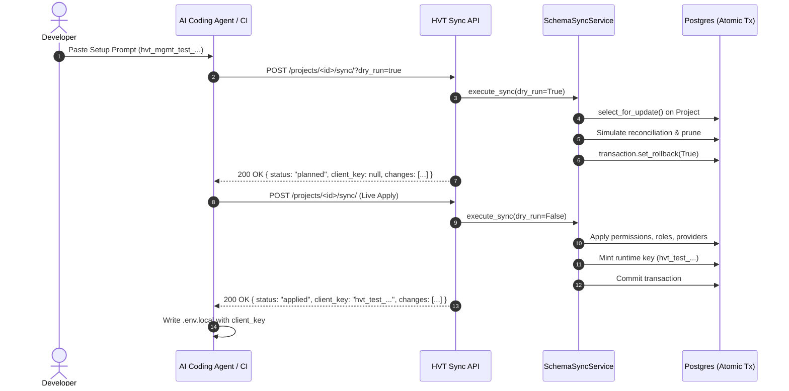
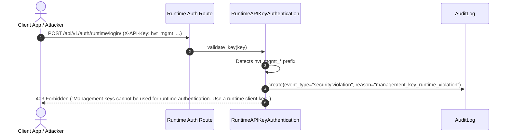

# AI-Native Declarative Schema Provisioning & Agent Developer Surface (v2)

* **Document Version:** 2.0.0
* **Status:** Implemented & Approved
* **License:** SPDX-License-Identifier: Apache-2.0
* **Date:** 2026-11-04
* **Authors:** HVT Core Team & Architect

---

## 1. Executive Summary

HVT is an open-source, multi-tenant authentication and identity engine providing a unified 15-feature authentication surface across both a Control Plane (developer dashboard) and a Runtime Plane (isolated customer authentication keyed by composite `project_id + email`).

This document specifies the **v2 AI-Native Declarative Schema Provisioning Surface**. It enables AI coding agents (such as Cursor, Claude Code, Copilot, and Antigravity) and CI/CD pipelines to manage and synchronize project authorization topology—roles, permissions, OAuth social providers, and authentication methods—declaratively via a single atomic endpoint (`POST /api/v1/organizations/current/projects/<uuid:project_pk>/sync/`).

---

## 2. Core Architecture & Architectural Principles

### 2.1 The Two-Plane Separation Model

HVT maintains a strict, cryptographic, and operational separation between two distinct architectural planes:

1. **Control / Provisioning Plane:**
   - **Key Format:** `hvt_mgmt_test_<64_hex_chars>` and `hvt_mgmt_live_<64_hex_chars>`.
   - **Authentication Class:** `ManagementAPIKeyAuthentication`.
   - **Allowed Scopes:** Provisioning scopes only (`schema:sync`, `schema:plan`, `roles:read/write`, `permissions:read/write`, `providers:read/write`).
   - **Restrictions:** Cannot be used on runtime authentication endpoints. Cannot create or rotate arbitrary API keys (apart from the runtime client key automatically minted by the sync service).
   - **Plane Violation:** Any management key presented to runtime routes (`/api/v1/auth/runtime/*`) is immediately rejected with HTTP `403 Forbidden` (`"Management keys cannot be used for runtime authentication. Use a runtime client key."`) and logs an immutable `security.violation` `AuditLog` event.

2. **Runtime Plane:**
   - **Key Format:** `hvt_test_<64_hex_chars>` and `hvt_live_<64_hex_chars>` (and legacy `hvt_client_*`).
   - **Authentication Class:** `RuntimeAPIKeyAuthentication`.
   - **Allowed Scopes:** Runtime scopes only (`auth:runtime`).
   - **Restrictions:** Cannot call management or provisioning endpoints. Cannot carry `schema:sync`, `schema:plan`, or `api_keys:write`.

### 2.2 Hosted Cloud Default for AI Agents & Developers

Unless self-hosting is explicitly requested by the user, AI agents building applications with HVT default to targeting the hosted cloud service at **`https://api.hvts.app`**. Developers and vibe coders only need their project ID and provisioning key from the dashboard; no local Docker containers or Postgres setups are required.

---

## 3. Critical User Journeys (CUJs)

### CUJ 0: Pull Request Schema Plan & Preview (Plan-Only)
* **Actor:** CI/CD Pull Request Action using a PR-scoped key (`schema:plan`).
* **Trigger:** Developer submits a PR modifying `hvt.schema.yaml`.
* **Execution:** Action runs `POST .../sync/?dry_run=true`.
* **Behavior:** Service performs full validation, adoption, reconciliation, and prune safety checks inside an atomic transaction, computes exact diffs and link removals, and calls `transaction.set_rollback(True)`. Returns `status: "planned"` and `client_key: null`.
* **Safety:** If the PR key attempts non-dry-run sync (`dry_run=false`), HVT rejects the request with HTTP `403 Forbidden` (`"The 'schema:plan' scope permits dry-run only. Use 'schema:sync' to apply changes."`).

### CUJ 1: First-Time Project Scaffolding by an AI Agent
* **Actor:** AI Coding Agent (Cursor / Claude Code / Antigravity).
* **Trigger:** Developer clicks "Copy AI Setup Prompt" in dashboard and pastes it to the agent. Key expires in 24 hours.
* **Execution:** Agent reads `llms.txt`, writes `hvt.schema.yaml`, and invokes `POST .../sync/`.
* **Behavior:** Service executes schema provisioning. Because no active runtime key exists for the project and environment, it mints a runtime client key (`hvt_test_...`) and returns it **once** in `client_key`.
* **Handoff:** Agent writes `NEXT_PUBLIC_HVT_CLIENT_KEY=hvt_test_...` into `.env.local` and scaffolds the frontend auth pages in under 10 minutes without secondary human intervention.

### CUJ 2: CI/CD Authorization Schema Synchronization with Safe Pruning
* **Actor:** Production Deployment Pipeline using a CI key (defaults to 90-day expiry).
* **Trigger:** Merged PR on `main` triggers production schema sync with `prune: true`.
* **Execution:** Pipeline executes `POST .../sync/?prune=true`.
* **Behavior:** Missing manifest-owned objects are pruned. If a role candidate is still held by assigned users (`UserProjectRole`), or a social provider candidate has linked user accounts (`SocialAccount`), pruning is **blocked** and rolls back with an actionable HTTP 400 error.

### CUJ 3: Accidental Management Key Rejection at Runtime
* **Actor:** Misconfigured client app.
* **Trigger:** Developer accidentally puts `hvt_mgmt_test_...` in frontend client code.
* **Behavior:** Runtime endpoint (`/api/v1/auth/runtime/login/`) rejects the key with HTTP `403 Forbidden` and message: `"Management keys cannot be used for runtime authentication. Use a runtime client key."` A security `AuditLog` event is written.

---

## 4. Sequence Diagrams

### 4.1 CUJ 0 & 1: Plan and Scaffolding Synchronization

### 4.2 CUJ 3: Plane Violation Defense

---

## 5. Specification of Changes (B.1 – B.9)

### B.1 Client Key Handoff & Minting
- **One-Time Handoff:** Keys are hashed via SHA-256; raw keys cannot be retrieved. A non-dry-run sync mints a runtime key only if none is currently active for the project environment, returning it once in `client_key`. Subsequent syncs return `client_key: null` and `client_key_prefix`.
- **Force Minting:** Passing `issue_client_key=true` mints an extra runtime key even if one is active.
- **Dry-Run Guarantee:** Dry runs (`dry_run=true`) always return `client_key: null` and persist zero database records.

### B.2 Secret Handling & Redaction
- **Manifest Flexibility:** `client_secret` is required when creating a new social provider. On subsequent updates, omitting `client_secret` keeps the existing encrypted secret.
- **Write-Only Guarantee:** Secrets are write-only. They are never returned in sync responses, diffs, validation payloads, or `AuditLog.event_data`.
- **Environment Interpolation:** CLI and agents resolve `${ENV_VAR}` references locally before sending. `llms.txt` explicitly instructs agents never to commit raw secrets.

### B.3 MultiFernet Encryption at Rest
- **Key Configuration:** Sensitive text fields (`SocialProviderConfig.client_secret`) are encrypted using `MultiFernet` with keys supplied via `HVT_ENCRYPTION_KEYS` (comma-separated urlsafe base64 keys). The first key encrypts; all keys decrypt.
- **System Check:** When `DEBUG=False`, `HVT_ENCRYPTION_KEYS` is mandatory. Django system check `check_encryption_keys` flags missing keys with error `hvt.E001`. In `DEBUG=True`, keys fallback to `SECRET_KEY` derivation with a logged warning.
- **Field & Storage:** `EncryptedTextField` prefixes ciphertext with version `v1:`. Legacy plaintext values are supported and upgraded idempotently.
- **Deterministic Diffs:** Diffs compare decrypted plaintext values because Fernet token generation is non-deterministic (timestamps + random IVs).

### B.4 Ownership & Pruning Safety
- **Ownership Tag:** `managed_by` (`dashboard` | `manifest`, default `dashboard`) is added to `ProjectRole`, `ProjectPermission`, and `SocialProviderConfig`.
- **Adoption:** Existing dashboard objects whose slug is declared in a manifest are adopted (`managed_by = "manifest"`) and reported with action `adopted`.
- **Pruning:** When `prune: true`, only manifest-owned objects missing from the manifest are eligible for deletion. Dashboard-owned objects are never pruned.
- **Referential Integrity Gates:**
  - Role deletion is blocked if any `UserProjectRole` rows exist.
  - Social provider deletion is blocked if any `SocialAccount` rows are linked.
- **Role Permission Reconciliation:** Roles are reconciled to exactly their declared permissions. Detached permissions are unlinked and listed in `link_removals`.

### B.5 Transactions, Locking & Singular Default Roles
- **Row-Level Locking:** All operations run inside `transaction.atomic()` with `Project.objects.select_for_update().get(id=project.id)` executed first to serialize concurrent syncs.
- **Role Deletion Protection:** `UserProjectRole.role` is set to `models.PROTECT`.
- **Singular Default Role:** Each project permits at most one `is_default_signup` role. If a manifest designates a default role, any prior default role in that project is automatically unset and reported.
- **Dry-Run Rollback:** Dry-run execution uses `transaction.set_rollback(True)`.

### B.6 Scopes, Key Lifecycle & Environment Safety
- **Scope Hierarchy:** `schema:sync` implies `roles:write`, `permissions:write`, `providers:write`, and `schema:plan`.
- **Plan Scope:** `schema:plan` authorizes dry-run previews only.
- **Scope Isolation:** Serializer and `clean()` prevent runtime keys from holding provisioning scopes and management keys from holding runtime auth scopes or `api_keys:write`.
- **Key Expiration:** AI setup prompt keys expire in 24 hours. CI keys default to 90 days.
- **Option C Environment Scoping:** Test management keys (`hvt_mgmt_test_...`) cannot mutate projects that possess active live runtime keys.

### B.7 Default-Deny & Plane Separation
- **Default-Deny Writes:** `_allow_api_key()` rejects write requests (`POST`, `PUT`, `DELETE`) unless the target view explicitly defines `api_key_write_scopes` or `api_key_scope_map`.
- **Dedicated Authentication Classes:** `RuntimeAPIKeyAuthentication` strictly rejects management keys with HTTP `403` and writes a `security.violation` `AuditLog`. `ManagementAPIKeyAuthentication` strictly rejects runtime keys.

### B.8 Redirect URI Validation
- **Manifest Field:** Mapped to `allowed_redirect_uris`.
- **Security Constraints:** Exact match required. Wildcards (`*`), URL fragments (`#`), and userinfo (`user:pass@`) are forbidden. HTTPS is required everywhere, with HTTP permitted only for `http://localhost` and `http://127.0.0.1` in the test environment.

### B.9 Spec Cleanup & Format Support
- **Canonical URL:** `POST /api/v1/organizations/current/projects/<uuid:project_pk>/sync/`.
- **Key/URL Validation:** Derives organization and project from the key; returns HTTP `404 Not Found` if the URL differs.
- **Format Flexibility:** Supports JSON (`application/json`) and YAML (`application/x-yaml`, `text/yaml`).
- **Schema Version:** Requires `schema_version: 1`.

---

## 6. Threat Model & Mitigations

| Threat | Impact | Mitigation in v2 |
| :--- | :--- | :--- |
| **Leaked OAuth Secret** | Third-party identity spoofing | Manifest `client_secret` is write-only, encrypted with `MultiFernet` (`v1:`), and redacted from diffs, responses, error payloads, and audit logs. |
| **Agent Commits Management Key** | Attacker modifies RBAC topology | Management keys cannot authenticate runtime users. AI prompt keys expire in 24h. Plane separation rejects management keys at runtime with 403. |
| **Accidental Prune of Admin Role** | Lockout of actual active users | Prune checks `UserProjectRole.objects.filter(role=candidate).exists()`. If users hold the role, prune is blocked and transaction rolls back. |
| **Accidental Prune of OAuth Provider** | End users locked out of social login | Prune checks `SocialAccount.objects.filter(provider=candidate.provider).exists()`. Prune is blocked if users are attached. |
| **Test Key Mutates Live Security** | Test pipeline breaks production RBAC | Option C enforcement: Test management keys (`hvt_mgmt_test_...`) are rejected with 403 if the project has active live keys. |
| **Open Redirect / Token Interception** | Authorization code theft | Exact matching on `allowed_redirect_uris`; wildcards, fragments, and userinfo forbidden; HTTPS enforced (HTTP localhost in test only). |
| **Cross-Tenant Project Traversal** | Key for Org A modifies Org B | Strict scoping: `Project.objects.get(id=pk, organization=key.organization)`. Key/URL mismatch returns 404. |
