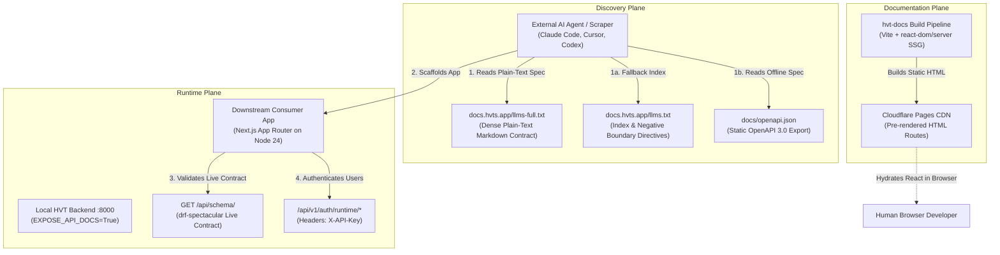

# Machine-Readable Developer Onboarding & Roadmap Calibration

* **Author:** HVT Core Team
* **Status:** Approved (Ready for Implementation)
* **Date:** 2026-11-07

--------------------------------------------------------------------------------

## Overview

HVT is an open-source, developer-first authentication platform designed for multi-tenant applications and modern developer environments. Modern application development increasingly relies on automated coding assistants (e.g., Claude Code, Cursor, Codex, Copilot) to discover, evaluate, and integrate infrastructure libraries.

This design document establishes the architecture and execution sequence to eliminate AI onboarding failures, provide machine-readable technical specifications, calibrate the strategic roadmap with current industry specifications, and transition the documentation site to static pre-rendering without introducing dynamic server overhead.

--------------------------------------------------------------------------------

## The Problem

When external automated coding agents attempt to integrate HVT into downstream applications (such as a Next.js App Router app), the integration breaks down due to three concrete failures:

1. **Client-Side Documentation Shell:** The documentation host (`docs.hvts.app`) is currently built as a client-side Single Page Application (SPA). An HTTP client or scraper executing `curl https://docs.hvts.app` receives an empty `<div id="root"></div>` without rendered documentation, code examples, or endpoint descriptions.
2. **Hallucination of Standard OIDC:** Starved of readable content, automated agents assume HVT follows standard OpenID Connect (OIDC) / OAuth2 authorization code redirect conventions (`/authorize`, `/oauth/token`). Agents scaffold generic `next-auth` or `auth.js` configurations that fail because HVT runtime authentication operates via direct REST endpoints (`/api/v1/auth/runtime/*`) with `X-API-Key` headers.
3. **Roadmap & Specification Inaccuracies:** The living roadmap document (`fe2proposal.md`) contains outdated assumptions regarding Model Context Protocol (MCP) authorization requirements (referencing RFC 8693 Token Exchange and RFC 9396 Rich Authorization Requests instead of the current MCP 2025-06-18 OAuth 2.1 standard), conflates developer organizations with end-user workspaces (`org_id` vs `workspace_id`), and lacks realistic target qualifiers.

--------------------------------------------------------------------------------

## Goals

* **Goal 1 (Machine-Readable Contract):** Provide plain-text, zero-JS entry points (`llms.txt`, `llms-full.txt`, and a static `docs/openapi.json` export) containing comprehensive endpoint schemas, header requirements, payload examples, and explicit boundary rules (`NOT OIDC / NextAuth / Auth.js`).
* **Goal 2 (Local Integration Verification):** Prove that an isolated external coding agent can successfully scaffold registration, login, logout, and protected session access in an empty Next.js App Router project using only the self-contained contract against a running local HVT backend (`http://localhost:8000`).
* **Goal 3 (Roadmap Realignment):** Correct `fe2proposal.md` to:
  * Explicitly label v0.2.0 as `v0.2.0-preview` until v0.2.1 hardening is completed and tagged.
  * Re-align Step 9 with the current MCP specification (OAuth 2.1, PKCE, RFC 9728, RFC 8707).
  * Distinguish developer control-plane accounts (`Organization`) from customer application multi-tenancy (`workspace_id`).
  * Restore Cloudflare Turnstile bot protection to roadmap milestones.
  * Re-bundle the living audit suite (`bundle.py`).
* **Goal 4 (Static Documentation Pipeline):** Pre-render `hvt-docs` at build time so that `docs.hvts.app` emits static HTML containing full text and code blocks on initial HTTP GET, eliminating empty SPA shells at zero ongoing hosting cost.

--------------------------------------------------------------------------------

## Non-Goals

* **Non-Goal 1 (Dynamic Server-Side Rendering):** Deploying a 24/7 Node.js or containerized SSR runtime for documentation. Static Site Generation (SSG) delivers complete HTML without server maintenance, crashes, or runtime hosting costs.
* **Non-Goal 2 (Speculative Authorization RFCs):** Implementing RFC 8693 Token Exchange or RFC 9396 RAR before the baseline OAuth 2.1 and asymmetric RS256 token foundation is stabilized.
* **Non-Goal 3 (Production Schema Mutations):** Modifying core database models or generating new backend migrations during this onboarding and documentation initiative.

--------------------------------------------------------------------------------

## Open Questions

* **Question 1 (SDK vs Direct REST):** In the local Next.js verification test, should the prompt strictly enforce the use of `@hvt/sdk`, or should it allow direct `fetch` calls to `/api/v1/auth/runtime/*` as a valid pass condition?
* **Question 2 (Edge Hosting Rules):** Does the Cloudflare Pages deployment configuration require specific rewrite adjustments in `_redirects` to resolve pre-rendered sub-paths (`/quickstart/index.html`) alongside client-side hydration assets?

--------------------------------------------------------------------------------

## Critical User Journeys (CUJs)

### CUJ 1: Automated Coding Agent Discovers and Integrates HVT
* **Given:** An automated coding agent (e.g., Claude Code, Cursor, Codex) is instructed to add user authentication to an application without prior knowledge of HVT.
* **When:** The agent fetches `https://docs.hvts.app/llms.txt` or `https://docs.hvts.app/llms-full.txt` using a non-JavaScript HTTP client.
* **Then:** The agent immediately parses the negative boundary instructions (`NOT OIDC / NextAuth`), reads the exact `/api/v1/auth/runtime/*` endpoint schemas and `X-API-Key` header rules, and generates correct REST calls without hallucinating OAuth authorization code flows.

### CUJ 2: Developer Initializes Local HVT Project via Self-Contained Prompt
* **Given:** A developer runs HVT locally at `http://localhost:8000` with `EXPOSE_API_DOCS=True` and mints a runtime test key (`hvt_test_...`).
* **When:** The developer copies the generated setup prompt from the HVT dashboard into an empty Next.js App Router project.
* **Then:** An external coding agent successfully implements register, login, logout, and protected route gating within a single session without guessing endpoints or stalling.

### CUJ 3: External Auditor Reviews Roadmap & Architecture Specifications
* **Given:** An external technical advisor or prospective customer reviews `fe2proposal.md` and `docs/audit/HVT_FULL_AUDIT_REPORT.md`.
* **When:** The auditor inspects authorization standards, multi-tenant workspace data models, and release statuses.
* **Then:** The documentation accurately reflects `v0.2.0-preview`, identifies `workspace_id` for tenant partitioning, cites standard MCP specifications (OAuth 2.1, PKCE, RFC 9728, RFC 8707), and provides verifiable evidence tags for all claims.

--------------------------------------------------------------------------------

## Technical Plan (Architecture)

### Architectural Overview



### 1. Phase 1: Machine-Readable Assets Implementation

#### A. Static OpenAPI Specification Export (`docs/openapi.json`)
To allow coding agents to inspect the API contract offline without launching a backend server, we export the schema directly via `drf-spectacular`:
```bash
python manage.py spectacular --file docs/openapi.json --format json
```
This file is committed to version control and directly linked in both repository documentation and `llms.txt`.

#### B. Plain-Text Ground Truth (`hvt-docs/public/llms-full.txt`)
We construct a standalone, zero-JS Markdown specification containing:
1. **Prominent Negative Boundary Directives:**
   ```markdown
   CRITICAL ARCHITECTURAL DIRECTIVE:
   HVT is NOT an OpenID Connect (OIDC), NextAuth, or Auth.js provider.
   HVT does NOT use authorization code redirects, /oauth/authorize, or /oauth/token.
   HVT is a direct REST authentication engine.
   All runtime requests MUST target /api/v1/auth/runtime/* with header:
     X-API-Key: <hvt_test_... or hvt_live_...>
   Do NOT guess endpoints or authentication flows.
   ```
2. **Environment Variable Conventions:**
   * `NEXT_PUBLIC_HVT_CLIENT_KEY`: Runtime key (`hvt_test_*` or `hvt_live_*`) safe for client-side inclusion.
   * `HVT_MANAGEMENT_KEY`: Control-plane key (`hvt_mgmt_*`) strictly prohibited from browser environments.
   * `NEXT_PUBLIC_HVT_API_URL`: Target backend base URL (e.g. `http://localhost:8000` or `https://api.hvts.app`).
3. **Complete Request/Response Payload Specifications:**
   * Registration: `POST /api/v1/auth/runtime/register/`
   * Login: `POST /api/v1/auth/runtime/login/`
   * Current User: `GET /api/v1/auth/runtime/me/`
   * Token Refresh: `POST /api/v1/auth/runtime/token/refresh/`
   * Password Reset: `POST /api/v1/auth/runtime/password/reset/`
   * Passkey Options & Verification: `POST /api/v1/auth/runtime/passkey/login/options/` & `.../verify/`
   * Magic Link Dispatch & Verification: `POST /api/v1/auth/runtime/magic-link/send/` & `.../verify/`
4. **Standard Error Envelope Specification:**
   * Documentation of the standardized error response format (`error.code`, `error.message`, `error.details`).

#### C. Updated Index (`hvt-docs/public/llms.txt`)
Refactored to lead with negative boundary rules, followed by direct links to `llms-full.txt`, the static `openapi.json`, and raw GitHub fallback URLs.

#### D. Self-Contained Setup Prompt Generator
Update `hvt/api/v1/views/organizations.py` (`ProjectSetupPromptView`) so that generated prompts include concrete example payloads for registration, login, and `/me/`, enabling disconnected agents to succeed without making secondary network fetches.

---

### 2. Phase 2: Empirical Verification Protocol (Next.js Local Integration)

#### A. Execution Environment
* Node.js version 24.x and npm 11.x.
* Clean temporary workspace: empty Next.js App Router (TypeScript, Tailwind CSS) project initialized via `npx create-next-app@latest`.

#### B. Execution Steps
1. Local HVT running on `http://localhost:8000` with `DEBUG=True` and `EXPOSE_API_DOCS=True`.
2. Extract project runtime test key (`hvt_test_...`) via `@hvt/cli` or database query.
3. Launch a fresh external coding agent session with the prompt:
   ```text
   Task: add HVT login to this Next.js (App Router) app. HVT is NOT OIDC, NextAuth or Auth.js. It is a REST API. Do not guess. If something below is missing or fails, stop and tell me.
   - HVT runs locally at http://localhost:8000. Read the full API contract at http://localhost:8000/api/schema/ before writing any code. If it disagrees with this prompt, trust the schema and tell me.
   - Runtime key (public): <paste hvt_test_... key>. Store it as NEXT_PUBLIC_HVT_CLIENT_KEY and send it as the X-API-Key header on every /api/v1/auth/runtime/ request.
   - Start with register, login and me under /api/v1/auth/runtime/.
   - Never put an hvt_mgmt_ key in the browser or in any NEXT_PUBLIC_ variable. I am not giving you one.
   Build: register, login, logout and a protected page showing the current user. Store the token as safely as you can and tell me your choice. Run the dev server and test against the real API. Report what worked, what you had to guess, and how long it took.
   ```
4. **Telemetry Rubric Recorded:**
   * Guess count (did it attempt to install `next-auth` or `auth.js`?).
   * Time-to-first-working-login.
   * Token persistence mechanism chosen (e.g., `httpOnly` route handler cookies vs local storage).
   * Exact stalls, schema mismatches, or error codes encountered.

---

### 3. Phase 3: Strategic Roadmap & Proposal Calibration

#### A. Updates to `fe2proposal.md`
1. **Release Status Labeling:** Retitle v0.2.0 references to `v0.2.0-preview` across Sections 1, 3, and 5. Position v0.2.1 Hardening as the formal security milestone before production designation.
2. **Model Context Protocol (MCP) Realignment (Step 9):**
   * Remove references to RFC 8693 (Token Exchange) and RFC 9396 (Rich Authorization Requests) as mandatory MCP requirements.
   * Explicitly bind Step 9 to the current Model Context Protocol (2025-06-18) authorization profile: **OAuth 2.1 with PKCE, Protected Resource Metadata (RFC 9728), and Resource Indicators (RFC 8707)**.
3. **Workspace Nomenclature Standard:**
   * Retain `Organization` strictly for the developer's administrative account in the control plane (`Organization` -> `Project`).
   * Standardize all end-user B2B multi-tenancy models and token claims under **`workspace_id`** (e.g., `Workspace`, `WorkspaceMembership`).
4. **Cloudflare Turnstile Restoration:** Reintroduce Cloudflare Turnstile bot verification into Step 2 and Step 4 milestones to defend against automated registration credential stuffing.
5. **Engineering Target Calibration:** Rephrase unmeasured performance claims (e.g. `<5 minutes`, `<0.2ms`) as explicit engineering targets. Replace *"thwarted at the gateway"* with defensible risk-reduction framing.

#### B. Audit Synchronization
* Update `docs/audit/00-summary.md`, `01-architecture-and-data.md`, `02-features-and-endpoints.md`, `07-roadmap-readiness.md`, and `09-fe2proposal-audit.md`.
* Execute `python docs/audit/bundle.py` to regenerate `HVT_FULL_AUDIT_REPORT.md` and `HVT_AUDIT_DOCS.zip`.

---

### 4. Phase 4: Build-Time Documentation Prerendering (SSG)

#### A. Static Generation Script (`hvt-docs/scripts/prerender.js`)
Instead of deploying a dynamic Node.js server container, we introduce a static build-time script:
1. Reads all route paths from `src/App.jsx` (`/`, `/introduction`, `/quickstart`, `/concepts`, `/guides/*`, `/sdk/*`, `/api`).
2. Uses `react-dom/server` (`renderToString`) to render the React tree for each route into static HTML.
3. Injects the rendered HTML into `dist/<route>/index.html`.
4. Result: `curl https://docs.hvts.app/quickstart` returns the full HTML document with all headings and code snippets in the body. When loaded in a browser, React hydrates seamlessly for client-side SPA navigation.

#### B. Cloudflare Pages Hosting Rules (`hvt-docs/public/_redirects`)
Verify and maintain static asset resolution:
```text
# Pre-rendered HTML routes resolve directly to their static index.html files
/introduction /introduction/index.html 200
/quickstart /quickstart/index.html 200
/concepts /concepts/index.html 200
/guides/* /guides/:splat/index.html 200
/sdk/* /sdk/:splat/index.html 200

# Client-side fallback for dynamic or unrendered routes
/* /index.html 200
```

--------------------------------------------------------------------------------

## Alternatives Considered

### Alternative A: Migrate `hvt-docs` to Dynamic Server-Side Rendering (Next.js / Remix SSR)
* **Pros:** Native server rendering on every incoming HTTP request; industry-standard framework pattern for web apps.
* **Cons:** Introduces runtime container dependencies, 24/7 Node.js process management (PM2/Docker), memory leak vulnerability, potential 500/504 errors on traffic spikes, and ongoing server hosting costs ($5–$20/month) for purely static technical documentation.
* **Reason for Rejection:** Documentation contains zero per-user session state or dynamic database models. Running live servers for static docs creates operational fragility with zero architectural benefit over build-time static HTML generation.

### Alternative B: Rely Exclusively on Headless Browser Crawling
* **Pros:** Zero changes required to the current Vite Single Page Application build.
* **Cons:** 95% of real-world automated coding agents (including Claude Code, Cursor, Codex, and terminal-based tools) do not launch headless Chromium instances to read documentation due to latency, memory, and token limits. They rely on standard HTTP `GET` / `curl`.
* **Reason for Rejection:** Completely fails the primary target persona (automated coding agents), continuing the failure mode where agents receive `<div id="root"></div>` and hallucinate OIDC redirect flows.

### Alternative C: Implement RFC 8693 (Token Exchange) & RFC 9396 (RAR) for Agent Tokens
* **Pros:** Highly granular, advanced delegation and fine-grained capability tokens.
* **Cons:** The Model Context Protocol (MCP) authorization specification (dated 2025-06-18) does not require or build upon RFC 8693 or RFC 9396. It standardizes on OAuth 2.1 with PKCE, Protected Resource Metadata (RFC 9728), and Resource Indicators (RFC 8707). Implementing speculative RFCs adds unnecessary protocol complexity before the baseline asymmetric token foundation is tagged.
* **Reason for Rejection:** Violates YAGNI (You Aren't Gonna Need It) and introduces protocol bloat that diverges from the upstream MCP specification.

--------------------------------------------------------------------------------

## Detailed Implementation Plan

The following enumeration details every file created, modified, or verified across the four phases:

### Phase 1: Machine-Readable Assets
1. **`docs/openapi.json` (CREATE)**
   * *Rationale:* Generate a static, offline-readable OpenAPI 3.0 contract using `drf-spectacular` (`python manage.py spectacular --file docs/openapi.json --format json`). Allows disconnected or air-gapped coding agents to inspect all schemas without running the backend server.
2. **`hvt-docs/public/llms-full.txt` (CREATE)**
   * *Rationale:* Author a single, zero-JS, consolidated Markdown document containing complete documentation, negative boundary rules (`NOT OIDC / NextAuth`), SDK initialization, runtime header requirements (`X-API-Key`), and exact request/response schemas for all `/api/v1/auth/runtime/*` endpoints.
3. **`hvt-docs/public/llms.txt` (MODIFY)**
   * *Rationale:* Refactor the existing index to prominently lead with negative boundary directives and link directly to `llms-full.txt`, `docs/openapi.json`, and raw GitHub main branch URLs.
4. **`hvt/apps/organizations/views.py` (MODIFY)**
   * *Rationale:* Enhance the `ProjectSetupPromptView` (`POST /api/v1/organizations/current/projects/<id>/setup-prompt/`) to ensure the generated prompt text contains fully self-contained JSON request payloads for registration, login, and `/me/`, along with the explicit `X-API-Key` header and negative boundary directives.

### Phase 2: Local Next.js Empirical Test
5. **`tests/test_ai_onboarding_e2e.py` or verification script (CREATE)**
   * *Rationale:* Provide an automated or reproducible harness to verify that the generated setup prompt correctly matches the runtime endpoints and that `EXPOSE_API_DOCS=True` serves the expected OpenAPI schema on `http://localhost:8000/api/schema/`.

### Phase 3: Strategic Roadmap Calibration
6. **`fe2proposal.md` (MODIFY)**
   * *Rationale:* Update document version to 1.4:
     - Relabel v0.2.0 references as `v0.2.0-preview` pending completion of v0.2.1 hardening.
     - Realign Step 9 to anchor MCP agent authorization strictly on OAuth 2.1 + PKCE + RFC 9728 + RFC 8707.
     - Mandate `workspace_id` for customer app multi-tenancy models while retaining `Organization` for control-plane developer accounts.
     - Restore Cloudflare Turnstile bot verification milestones.
     - Qualify performance claims (`<5 minutes`, `<0.2ms`) as target metrics.
7. **`docs/audit/00-summary.md` (MODIFY)**
   * *Rationale:* Update summary table and open findings to reflect `v0.2.0-preview` labeling and recent security fixes.
8. **`docs/audit/01-architecture-and-data.md` (MODIFY)**
   * *Rationale:* Clarify the architectural distinction between control-plane `Organization` and customer-facing `workspace_id`.
9. **`docs/audit/02-features-and-endpoints.md` (MODIFY)**
   * *Rationale:* Document the availability of static `docs/openapi.json` and the self-contained setup prompt endpoint.
10. **`docs/audit/07-roadmap-readiness.md` (MODIFY)**
    * *Rationale:* Realign Step 9 roadmap readiness with the MCP 2025-06-18 specification.
11. **`docs/audit/09-fe2proposal-audit.md` (MODIFY)**
    * *Rationale:* Update audit claims and evidence markers to match `fe2proposal.md` v1.4.
12. **`docs/audit/bundle.py` (EXECUTE)**
    * *Rationale:* Re-run bundler to synchronize `docs/audit/HVT_FULL_AUDIT_REPORT.md` and `docs/audit/HVT_AUDIT_DOCS.zip`.

### Phase 4: Build-Time Documentation Prerendering (SSG)
13. **`hvt-docs/scripts/prerender.js` (CREATE)**
    * *Rationale:* Provide a build-time script using `react-dom/server` that renders the route manifest into static HTML files (`dist/<route>/index.html`) during `npm run build`.
14. **`hvt-docs/package.json` (MODIFY)**
    * *Rationale:* Add a post-build prerender step: `"build": "vite build && node scripts/prerender.js"`.
15. **`hvt-docs/public/_redirects` (MODIFY)**
    * *Rationale:* Ensure Cloudflare Pages resolves static pre-rendered routes directly without rewriting to an empty SPA root.
