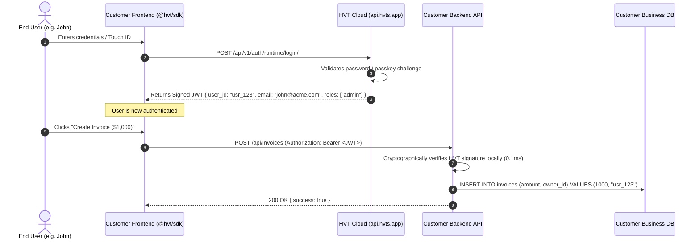
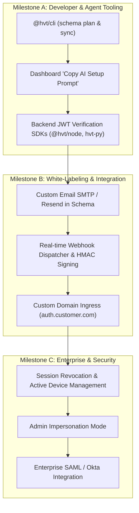

# HVT Phase 2 Architecture & Feature Proposal (`fe2proposal.md`)

* **Document Version:** 1.0.0
* **Date:** 2026-11-04
* **Target Audience:** Core Engineering Team, Founders, Product Leads
* **Status:** Proposal for Team Review & Decision

---

## 1. Executive Summary & Vision

HVT has established a production-grade, 15-feature authentication engine under the **Apache-2.0** license with strict two-plane separation (`RuntimeAPIKeyAuthentication` vs `ManagementAPIKeyAuthentication`), database encryption at rest (`MultiFernet`), and an atomic declarative schema provisioning endpoint (`POST /api/v1/organizations/current/projects/<id>/sync/`).

This document outlines the **Phase 2 Roadmap** required to transition HVT from a self-contained backend API into an **end-to-end, commercially viable, AI-native identity platform** comparable to Clerk, Auth0, and Supabase.

---

## 2. Real-World Architecture: How Customer Apps Communicate with HVT

A frequent question when building an auth provider is:
> *"If HVT stores the user logins and passwords, how does the customer's application store documents, invoices, or messages, and how do they talk to HVT?"*

### 2.1 The Two-Store Model (Separation of Concerns)

1. **HVT Stores (The Identity Vault):**
   - User identities, email verification states, password hashes (Argon2), biometric WebAuthn credentials, TOTP secrets, OAuth provider tokens, and project-level RBAC roles.
2. **Customer App Stores (The Business Database):**
   - Invoices, blog posts, messages, teams, orders, and products in their own Postgres, MongoDB, or MySQL database.
3. **The Bridge:**
   - The two systems are joined cleanly by an immutable string: **`user_id`** (e.g., `usr_98a72b`).

### 2.2 The JWT Passport Flow

Instead of requiring the customer's backend to query HVT over the network on every HTTP request, HVT issues a **Cryptographic Passport (Signed JWT)**:



---

## 3. High-Priority Features for Phase 2

### 3.1 The HVT CLI (`@hvt/cli`)
* **Problem:** Currently, calling the declarative schema sync requires raw `curl` or HTTP requests. AI agents and developers need a zero-friction terminal command.
* **Solution:** A TypeScript/Node CLI runnable via `npx @hvt/cli` across any stack (Python, Go, Rust, Node, Ruby, PHP).
* **Capabilities:**
  - `hvt init`: Scaffolds `hvt.schema.yaml` and populates `.env.local` with the runtime client key.
  - `hvt schema plan`: Resolves `${SECRET}` variables locally, calls `?dry_run=true`, and outputs color-coded terminal diffs (additions, adoptions, reconciliations, link removals).
  - `hvt schema sync`: Reconciles the schema atomically, supports `--prune` and `--issue-client-key`.
  - `hvt whoami`: Inspects project connection, scopes, and key expiration.

---

### 3.2 Real-Time Webhooks Engine
* **Problem:** When a user signs up on HVT, the customer’s backend needs to automatically create a Stripe customer, send a Slack alert, or provision a row in their local database.
* **Solution:** An asynchronous webhook delivery system inside HVT.
* **Specifications:**
  - **Standard Events:** `user.created`, `user.updated`, `user.deleted`, `session.created`, `role.assigned`, `security.violation`.
  - **Security:** Every webhook payload is signed with an HMAC-SHA256 signature header (`X-HVT-Signature: t=...,v1=...`) to prevent spoofing.
  - **Reliability:** Exponential backoff retry queue (1m, 5m, 15m, 1h, 24h) for failed endpoints.
  - **Dashboard Interface:** Webhook log viewer with request payloads, response codes, and manual replay buttons.

---

### 3.3 White-Label Emails & Custom SMTP / Resend Integration
* **Problem:** Emails currently send from default templates. Customers want emails to come from their own domain (`auth@customer.com`) with their custom styling.
* **Solution:**
  1. **Tier 1 (Starter Default):** HVT sends clean, responsive emails with the customer's App Name, Logo, and Brand Color.
  2. **Tier 2 (Bring Your Own Provider):** Customers plug in their own email provider via dashboard or `hvt.schema.yaml`:
     ```yaml
     email:
       from_name: "Acme Security"
       from_email: "auth@acme.com"
       provider: resend # Options: resend, sendgrid, postmark, ses, smtp
       api_key: "${RESEND_API_KEY}"
     ```
  3. **Custom HTML / Markdown Templates:** Customizable email templates for verification, password resets, magic links, and team invites.

---

### 3.4 Custom Domains (`auth.customer.com`)
* **Problem:** Showing `api.hvts.app` in OAuth redirect bars degrades brand trust. Furthermore, modern browsers (Safari ITP) restrict third-party cookies across different domains.
* **Solution:** First-party custom domain mapping.
* **Implementation:**
  - Customer creates a CNAME record: `auth.customer.com CNAME custom.hvts.app`.
  - HVT ingress proxy (Cloudflare for SaaS or Caddy) automatically issues and renews Let's Encrypt / DigiCert SSL certificates.
  - Incoming requests on `auth.customer.com` are mapped directly to the customer's `project_id`.
  - Result: 100% white-labeled URLs and flawless first-party session cookie persistence.

---

### 3.5 Dashboard "Copy AI Setup Prompt" & 1-Click Agent Handoff
* **Problem:** Vibe coders using Cursor, Claude Code, or Antigravity shouldn't have to manually write `.env` files or figure out API URLs.
* **Solution:** A prominent **"Copy AI Setup Prompt"** button on the project overview page:
  - Generates an ephemeral **24-hour test management key** (`hvt_mgmt_test_...`) with `schema:sync` scope.
  - Copies an optimized markdown prompt containing the Project ID, Base URL (`https://api.hvts.app`), and step-by-step instructions for the agent to inspect `llms.txt`, write `hvt.schema.yaml`, sync to HVT, and save the minted client key to `.env.local`.

---

## 4. Additional High-Value Features (Not Previously Discussed)

These features represent major value-drivers found in enterprise identity platforms (Okta, Auth0, Clerk):

### 4.1 Session Management & Device Revocation
* View all active sessions for a user (IP address, approximate geolocation, browser, operating system, last active time).
* "Log out of all other devices" functionality (essential for security compromise recovery).
* Configurable idle and absolute session timeouts per project.

### 4.2 Super-Admin Impersonation Mode
* **Use Case:** A customer opens a support ticket saying *"I can't see the billing page in my dashboard."*
* **Solution:** A developer or support agent with `org:admin` permissions can click "Impersonate User" in the HVT dashboard.
* **Security Guardrails:**
  - Generates a short-lived impersonation token (max 15 minutes).
  - Explicitly marked in the JWT: `impersonated_by: "admin_user_id"`.
  - Writes an immutable `audit.impersonation` event to the Security Audit Log.

### 4.3 Enterprise SSO & SCIM 2.0 (B2B Expansion)
* **SAML 2.0 / OIDC Enterprise Connections:** Allow B2B customers to log in using their corporate Identity Providers (Okta, Microsoft Entra ID / Azure AD, Google Workspace, Ping Identity).
* **SCIM 2.0 Directory Sync:** Automatically provision and deprovision users when an employee joins or leaves their company.

### 4.4 Backend Verification Libraries (Fast JWT Verification)
* Provide lightweight, zero-dependency JWT verification packages so customer backends can verify HVT tokens in 1 line of code without network overhead:
  - `@hvt/node` (Node.js / Express / Fastify / Next.js API)
  - `hvt-py` (FastAPI / Django / Flask)
  - `hvt-go` (Go standard library / Gin / Fiber)

### 4.5 Brute-Force & Bot Defense (Turnstile / reCAPTCHA)
* Native integration with Cloudflare Turnstile or Google reCAPTCHA v3.
* Invisible bot detection on passwordless magic link requests, signup endpoints, and password reset forms to prevent spam attacks.

### 4.6 Metered Usage & Billing Analytics
* An automated tracking pipeline that aggregates **Monthly Active Users (MAUs)**, total authentications, and active projects.
* Stripe billing integration for the hosted cloud platform (`hvts.app`) providing tiered plans (Free Starter, Pro, Team, Enterprise).

---

## 5. Comparative Competitive Matrix

| Capability | Clerk | Auth0 | Supabase Auth | HVT (Phase 1 + 2) |
| :--- | :---: | :---: | :---: | :---: |
| **All 15 Auth Features (Passkeys, TOTP, Magic Links, OAuth)** | ⚠️ Partial (Passkeys paid) | ✅ Complete | ⚠️ Partial | **✅ Complete** |
| **Declarative YAML Schema Sync** | ❌ No | ⚠️ Clunky JSON | ❌ No | **✅ Native (`hvt.schema.yaml`)** |
| **CLI Sync (`schema plan` & `schema sync`)** | ❌ No | ⚠️ Clunky a0deploy | ⚠️ DB only | **✅ `@hvt/cli`** |
| **AI-Agent Ready (`llms.txt` + Auto Key Handoff)** | ❌ Dashboard required | ❌ Too complex | ❌ Partial | **✅ Native First-Class** |
| **Webhooks with HMAC Signatures** | ✅ Yes | ✅ Yes | ✅ Yes | **Planned Phase 2** |
| **Custom Domains & White-label Email** | ✅ Paid add-on | ✅ Paid add-on | ⚠️ Bring your own | **Planned Phase 2** |
| **License** | Closed Source | Closed Source | Apache-2.0 | **Apache-2.0 (Full Engine)** |

---

## 6. Implementation Roadmap & Recommended Phases



---

## 7. Open Questions for the Team

1. **CLI Distribution:** Should `@hvt/cli` live in this repository under a `cli/` monorepo directory, or in a separate repository like `hvt-sdk`?
2. **Email Strategy:** Should we offer a shared HVT email pool by default for free projects (capped at e.g. 100 emails/month), requiring custom SMTP/Resend for higher volumes?
3. **Webhook Infrastructure:** Should we use Celery + Redis (already in our stack) for webhook delivery, or integrate a dedicated service like Svix?
4. **Custom Domain Architecture:** Should we terminate custom domain SSL using Cloudflare for SaaS or an automated Caddy reverse proxy?
