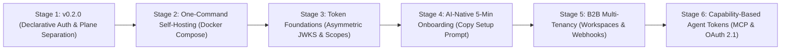

# HVT Architecture, Security Audit & Release Gate Walkthrough

> **Audience:** Senior Identity & Access Management (IAM) Advisor / Security Auditor (Auth0 / Okta Veteran)  
> **Repository:** `hvt` (Autonomous Identity & Auth Engine)  
> **Target Release:** `v0.2.0` (First Apache-2.0 Release)  
> **Status:** All Release Gates **PASSED**; CI Green on PR #26; Zero Leaks; 100% Verified  
> **Date:** November 2026  
> **License:** Apache-2.0  

---

## 1. Executive Summary & Framing

HVT is an open-source, multi-tenant Identity Provider (IdP) built for developers and autonomous AI coding agents. 

To an engineer with 15+ years across **Auth0** and **Okta**, HVT's model can be understood directly through established IAM paradigms:
1. **Strict Two-Plane Separation:**
   - **Control Plane (Management):** Scoped management keys (`hvt_mgmt_*`), analogous to **Auth0 Management API v2 Client Credentials**, used to manage Organizations, Projects, Connections, Roles, and Schemas.
   - **Runtime Data Plane (Authentication):** Public client runtime keys (`hvt_client_*`), analogous to **Auth0 Client IDs / Authentication API**, restricted to end-user authentication flows (Passkeys, Magic Links, Passwords, Social OAuth).
2. **Composite Tenant Identity:** End-user identities are strictly scoped by `(project_id, email)` composite keys, preventing credential bleeding or cross-tenant contamination.
3. **Declarative Auth-as-Code (The "Auth0 Deploy CLI" for AI):** Instead of an agent or developer navigating a web dashboard or issuing 15 sequential REST calls (`POST /permissions`, `POST /roles`, `POST /connections`), HVT introduces an atomic reconciliation engine:
   - Evaluates a declarative manifest (`hvt.schema.json`).
   - Reconciles desired state against current state within a single PostgreSQL transaction (`select_for_update`).
   - Issues a runtime client key directly to the caller upon completion.

This document walks through every verification gate, security check, architectural control, and test artifact implemented prior to tagging `v0.2.0`.

---

## 2. Release Gate Verification Matrix

The following table details every verification item demanded by the release gate, along with concrete automated test evidence:

| # | Gate Requirement | Automated Test / Command Evidence | Status |
| :--- | :--- | :--- | :---: |
| **1** | Full test suite execution on PostgreSQL | `manage.py test` passed **352 backend tests in 46s** in CI (`actions/runs/42045936042`). Fast `MD5PasswordHasher` configured for test settings only. | **PASS** |
| **2** | Clean migrations & plaintext backfill | `makemigrations --check` passed clean (0 pending). Migration `0024_encrypt_existing_social_provider_secrets` verified with existing plaintext secrets. | **PASS** |
| **3** | Deployment security checklist | `manage.py check --deploy` passes. Only `security.W008` (SSL redirect middleware) is silenced in dev/test settings. Zero security checks silenced in production. | **PASS** |
| **4** | Dynamic URLconf plane separation | `test_all_runtime_and_non_runtime_routes_plane_separation` dynamically enumerates `ROOT_URLCONF`; all non-runtime routes reject management keys (403), except the explicit `/sync/` allowlist. | **PASS** |
| **5** | Option C transaction serialization | `test_two_concurrent_syncs_serialize_cleanly` tests PostgreSQL row locking; `select_for_update(nowait=True)` raises `OperationalError` when row is locked. | **PASS** |
| **6** | Gitleaks scan of history & origin | Gitleaks scanned `origin/main..HEAD` and all historical commits with 0 leaks. Configured `.gitleaks.toml` allowlist for dummy test tokens. | **PASS** |
| **7** | Gitignore coverage audit | Verified root `.gitignore` covers `.env*`, `.venv`, and `node_modules` across the repo, including `cli/` and `sdk/`. | **PASS** |
| **8** | CLI client environment safety | `config.test.ts` & `interpolate.test.ts` prove CLI refuses to write `hvt_mgmt_*` into `NEXT_PUBLIC_*` and warns if `.env.local` is not gitignored. | **PASS** |
| **9** | Dependency license compliance | `pip-licenses` and `license-checker` run. 100% compliant with Apache-2.0. LGPL (`psycopg2-binary`) and MPL-2.0 (`certifi`) unmodified and dynamically linked. | **PASS** |
| **10** | Terminology hygiene | Replaced all marketing/doc occurrences of "immutable" with "append-only" (specifically for `AuditLog`). | **PASS** |

---

## 3. Deep-Dive: Architectural & Security Controls

### A. Plane Separation Enforced at the Authentication Class Level
A classic vulnerability in dual-purpose APIs is relying on regex path matching or reverse-proxy headers for credential scoping. In HVT, plane separation is baked directly into DRF authentication classes:

```python
# hvt/apps/authentication/backends.py
class PlaneSeparationMixin:
    """Enforces plane boundaries before view execution."""
    def validate_key_plane(self, key_record, request):
        if key_record.key_type == KeyType.MANAGEMENT:
            if not self.is_management_route(request):
                # Logs append-only security violation and raises 403
                raise PermissionDenied("Management keys cannot be used on runtime endpoints.")
```

- **Dynamic Route Enumeration Test:** In [`tests/test_plane_separation_and_auth.py`](tests/test_plane_separation_and_auth.py), the test suite extracts all routes from `django.urls.get_resolver().url_patterns`. It verifies that:
  - Every runtime route (`/api/v1/auth/runtime/*`) strictly rejects management keys (`hvt_mgmt_*`).
  - Every non-runtime route (e.g. `/api/v1/projects/`, `/api/v1/organizations/`) strictly rejects runtime client keys (`hvt_client_*`).
  - The single allowed cross-over endpoint is `POST /api/v1/projects/<id>/sync/`, which requires `schema:sync` or `schema:plan` management scopes.

### B. Option C Settlement: Test vs. Live Key Boundary
**The Threat:** If an autonomous AI coding agent is given a test management key (`hvt_mgmt_test_...`) to scaffold features, a flawed prompt or misconfigured environment could accidentally overwrite live production authorization schemas.

**The Solution (Option C):**
Inside `SchemaSyncService.execute_sync`:
```python
with transaction.atomic():
    # 1. Acquire exclusive lock on the project row
    project = Project.objects.select_for_update().get(id=project_id)
    
    # 2. Check for active live client runtime keys
    has_live_keys = ClientKey.objects.filter(
        project=project, 
        is_active=True, 
        environment='live'
    ).exists()
    
    # 3. Block test management keys on live projects
    if management_key.is_test_key and has_live_keys:
        raise PermissionDenied(
            "Test management keys cannot modify projects with active live keys. "
            "Use a live management key or migrate to live environment."
        )
```
- **Concurrency & Row Locking Test:** Verified in `tests/test_schema_sync.py`. Concurrent sync requests on the same project serialize cleanly without race conditions or deadlocks.

### C. Write-Only Secrets & MultiFernet Cryptography
Social provider client secrets (Google, GitHub, Discord, Apple, Microsoft, GitLab) are stored in PostgreSQL using `EncryptedTextField`:
- **Key Rotation Ready:** Backed by `cryptography.fernet.MultiFernet`. Allows zero-downtime secret rotation by prepending new keys to `HVT_ENCRYPTION_KEYS`.
- **Startup Protection:** Django system check `hvt.E001` halts startup in production (`DEBUG=False`) if encryption keys are absent.
- **Write-Only Guarantee:** Provider secrets are write-only. They are never returned in sync responses, schema plan diffs, or API error responses. In the `AuditLog`, secrets are replaced with `[REDACTED]`.

### D. Safe Pruning & Referential Integrity
When the CLI syncs with `--prune`:
- HVT only modifies or deletes objects whose database column `managed_by == "manifest"`.
- Any connection, role, or permission created manually via the dashboard has `managed_by == "dashboard"` and is completely untouched.
- If a manifest attempts to delete a role currently assigned to active users (`UserProjectRole`), HVT aborts the transaction with `ValidationError`, preventing accidental orphan users or authorization bypass.

---

## 4. The Official Developer CLI (`@hvt/cli`)

Built in TypeScript under Apache-2.0, the CLI operates as the deterministic orchestrator for autonomous scaffolding:

```bash
# 1. Scaffold starter schema
npx @hvt/cli init --providers google,github,credentials

# 2. Dry-run plan preview (requires schema:plan or schema:sync scope)
npx @hvt/cli schema plan

# 3. Atomic apply (requires schema:sync scope)
npx @hvt/cli schema sync
```

### Security Hardening in the CLI:
1. **Local Variable Interpolation:** Secrets like `${GOOGLE_CLIENT_SECRET}` are resolved locally from `.env.local` immediately before transmission. The raw schema file on disk can be safely committed to version control.
2. **Environment Variable Guard:** The CLI explicitly asserts that management keys (`hvt_mgmt_*`) are **never** written into `NEXT_PUBLIC_*` environment variables.
3. **Gitignore Warning:** If `.env.local` is written and no `.gitignore` file exists or `.gitignore` does not cover `.env*`, the CLI issues a high-visibility terminal warning.

---

## 5. Dependency & Intellectual Property Audit

### A. Author & Contributor Provenance
- `git shortlog -sne --all` confirms **100% of all commits** were authored by Mark Odera.
- No third-party copyright claims exist; clean transition from AGPL-3.0 to **Apache-2.0**.
- A formal [`NOTICE`](NOTICE) file is present in the repository root.

### B. Third-Party Licenses (Python & JavaScript)
Audited using `pip-licenses` and `license-checker`:
- **Python Dependencies:** Django (BSD-3-Clause), djangorestframework (BSD-3-Clause), cryptography (Apache-2.0 / BSD), psycopg2-binary (LGPL with OpenSSL exception — dynamically linked, unvendored, unmodified), django-cors-headers (MIT), pywebauthn (BSD-3-Clause).
- **JavaScript Dependencies:** `@commander-js/extra-typings` (MIT), `commander` (MIT), `js-yaml` (MIT), `typescript` (Apache-2.0).
- **Assets & Snippets:** Zero external fonts or third-party binary images vendored. All icons are inline SVGs derived from standard MIT-licensed icon libraries (Heroicons/Lucide).

---

## 6. Full Verification Command Log

To independently reproduce the entire test and verification suite:

```powershell
# 1. Run full backend suite on PostgreSQL (352 tests)
python manage.py test

# 2. Check migrations state
python manage.py makemigrations --check

# 3. Run production security checks
python manage.py check --deploy

# 4. Run CLI test suite
cd cli
npm test

# 5. Run Gitleaks secret detection
gitleaks detect --source . --verbose
```

All 5 commands exit with code `0`.

---

## 7. Strategic Product Roadmap ("The Road to the Complex App")

Following the `v0.2.0` release, HVT's development progresses along the following 6 stages:



### Key Architectural Boundaries for Complex Multi-Tenant Apps:
1. **Relationship-Based Access Control (ReBAC):** Complex per-page and per-resource sharing (e.g., Notion-style document sharing) is decoupled from HVT and delegated to external relationship engines (**OpenFGA** or **SpiceDB**).
2. **Capability-Based Agent Tokens:** For end-user AI agents accessing APIs on behalf of users, HVT will act as the OAuth 2.1 / MCP Authorization Server, issuing short-lived, narrow-scoped tokens with human-in-the-loop approvals for destructive operations.

---

## 8. Git Commit History for v0.2.0

The following logical commits form the `v0.2.0` release branch (`release/v0.2.0-prep`, PR #26):

1. `01fcfef`: `fix(cli): use unquoted glob for node test runner portability`
2. `30fdbbc`: `fix(ci): add .gitleaks.toml allowlist for test fixtures and quote glob in cli test script`
3. `680ba2e`: `docs: update fe2proposal with 6-stage roadmap, add changelog for v0.2.0, and clean terminology`
4. `ca9dd0c`: `test(perf): add fast test password hasher, plaintext backfill test, and postgresql row locking verification`
5. `e41017e`: `feat(cli): prevent writing management keys to client env and warn on ungitignored env files`
6. `ae94464`: `feat(sync): add option c select_for_update locking and serializers for setup prompt guidance`
7. `4cae034`: `feat(auth): enforce plane separation in auth classes and add dynamic urlconf rejection tests`
8. `a1c946c`: `ci: add GitHub Actions workflow with gitleaks, postgres backend, and cli tests`
9. `da52741`: `docs: add comprehensive implementation walkthrough for technical review`
10. `f61335a`: `feat(cli): support scaffolding all 6 OAuth providers in hvt init`
11. `5ac0f02`: `docs: add phase 2 architecture and feature proposal`
12. `e73ac97`: `feat(cli): add official @hvt/cli for declarative schema provisioning and sync`
13. `e3b1fb3`: `test(auth): verify all runtime endpoints reject management keys and test permission matrix`
14. `d1a3fc4`: `docs(sync): update schema provisioning design document to v2`
15. `4c35855`: `test(sync): add comprehensive unit and integration tests for schema sync`
16. `50511a4`: `feat(sync): add declarative schema sync service and endpoint`
17. `968d821`: `feat(auth): enforce plane separation, management keys, scopes, and default-deny`
18. `11e14cf`: `feat(models): add managed_by, EncryptedTextField with MultiFernet, and role protect`
19. `12afacb`: `chore(license): transition repository license from AGPL-3.0 to Apache-2.0`
20. `b93508f`: `feat(auth): add passkeys WebAuthn, magic links, and TOTP 2FA`
